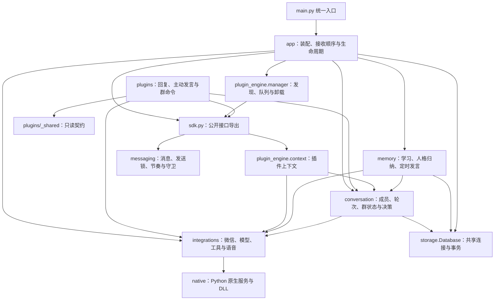

# 架构

项目边界、目录职责、依赖方向、资源归属与扩展落点；具体行为见各功能 spec：
[messages](../messages/spec.md)、[delivery](../delivery/spec.md)、[learning](../learning/spec.md)、
[lifecycle](../lifecycle/spec.md)、[announcements](../announcements/spec.md)、
[mention-reply](../mention-reply/spec.md)、[profiles](../profiles/spec.md)、[proactive-chat](../proactive-chat/spec.md)、[idiom-chain](../idiom-chain/spec.md)。

## 边界

- 运行平台为 Windows x64 与 64 位 Python；原生桥接负责文本和群图片收发、群语音接收及原生语音条发送。图片按需经 Magpie 识别；群语音在本机转写成普通发言。C++ 内部不在本规范范围。
- 统一入口是 `main.py`：解析参数、装配应用、启动主循环。
- 功能以插件实现；配置字段、用户命令、脚本入口与插件目录名保持兼容。
- spec 只写已经实现的行为；计划中的改动留在 `docs/` 的计划文档。

## 目录职责

下表中的包内短路径相对于 `wxbot_framework/`。

| 目录 / 文件 | 职责 |
|---|---|
| `main.py` | 统一入口：参数、日志、检查分支、启动 |
| `wxbot_framework/sdk.py` | 插件可用接口的稳定导出 |
| `wxbot_framework/config.py`、`feature_config.py` | 配置读写与纯校验、功能选项解析 |
| `commands.py` / `authorization.py` / `timeutil.py` / `locking.py` / `account.py` / `contacts.py` / `lore.py` / `native_profiles.py` | 命令、权限、时间、锁、账号与联系人读取、背景资料、客户端构建信息 |
| `images.py` / `image_metadata.py` / `image_receiver.py` / `recent_images.py` | 图片保存、元数据解析、异步下载与最近图片索引；由原生服务接入 |
| `app/` | 装配与显式初始化（`bootstrap.py`）、主循环（`runtime.py`）、消息顺序（`ingress.py`）、控制台、维护、检查命令、公告、资料修订 |
| `messaging/` | 消息模型、发送、节奏、接收水位、文本与艾特工具 |
| `plugin_engine/` | 清单、发现与加载、插件上下文 |
| `conversation/` | 成员与历史、群状态、按成员的对话轮次、总结、群人格与清空控制；主动发言决策和预算（`planner.py`）、复读识别（`repetition.py`）、艾特工具判断与调用（`tool_router.py`、`mention_tools.py`） |
| `memory/` | 知识库与维护、增量学习、人格习惯归纳、定时主动发言；事件驱动发言由 `plugins/proactive_chat/` 持有 |
| `storage/` | 唯一连接与事务、集中迁移 |
| `integrations/` | 原生微信适配、大模型与 Jev 客户端、Magpie 看图/联网及限时 HTTP；本地语音识别、合成子进程与 SILK 编码 |
| `plugins/mention_chat/` | 艾特、定向接话、冷处理与语音命令；复用 `conversation/slow_replies.py` 管理慢回复，`voice_reply.py` 管理语音回复与本地音色资源 |
| `plugins/proactive_chat/`、`plugins/personality/` | 事件驱动发言与群聊加一；群人格命令。共用框架的群状态、人格快照与发送接口 |
| `plugins/_shared/` | 插件之间的只读数据契约 |
| `plugins/_template/` | 插件模板 |
| `native/` | 桥接源码与 DLL，以及 Python 原生服务；`text_service.py` 负责多媒体接收、原生调用和连接资源 |
| `tests/`、`tools/` | 离线测试；配置、迁移、评测及运维脚本，包含 `bot_ctl.ps1`、`bot_daemon.py` 的后台运行入口 |
| `docs/` | 计划、评测与配图；架构流程图以 `docs/diagrams/*.mmd` 为源，同步到对应 spec 的 Mermaid 图块 |

## 依赖方向

<!-- diagram: ../../docs/diagrams/layers.mmd -->

图中展开装配、插件公开接口与外部适配的主要依赖。`sdk.py` 导出接口，具体实现由消息层和插件上下文持有。

| 规则 | 说明 |
|---|---|
| 装配只发生在 `app` | `main → app → 功能模块 / 插件引擎 / 适配器`；底层不得导入 `app` |
| 单向依赖 | `memory` 可用 `conversation` 的公开成员、历史与版本接口；`conversation` 不反向依赖 `memory`。两者可使用 `integrations` 中的客户端 |
| 引擎不认识插件 | `plugin_engine` 负责发现、加载、生命周期与分发，不引用具体插件；入口不按插件名判断服务需求 |
| 插件边界 | 插件通过 `wxbot_framework.sdk` 与公开功能接口工作；插件之间只共享 `plugins/_shared/` 的只读契约 |
| 静态检查 | `tests/test_architecture.py` 检查底层不导入 `app`、引擎与入口不引用受检查的具体插件、插件不互相导入，并验证 SDK 导出；同层依赖及资源退出另需核对所属实现与功能测试 |

## 资源归属

- `storage.Database` 是唯一的 SQLite 连接：持有连接、可重入锁、可嵌套事务与备份；成员、历史、知识库与群状态共用，不各自开连接。
- 事务由用例控制：下层写方法只执行 SQL，异常沿调用栈抛出，不留半批结果。
- 只有显式初始化会建库与迁移：`app/bootstrap.py` 的 `startup_services()` 与 `open_knowledge()`；解析配置、读取插件上下文属性不写数据库。
- 停止顺序与未完成时的处理见 [lifecycle](../lifecycle/spec.md)；检查命令（`--check` / `--list-plugins`）不建库、不注入微信、不请求模型。
- 图片保存目录由 `image_directory` 配置（默认 `.runtime/images`），原生服务按账号隔离后交给 `ImageStore`；原始图片 XML、CDN 地址与密钥只存在于解析和下载请求内部，不进入插件消息。
- 原生加载只接受已知客户端版本和核心文件指纹。账号、联系人和原生调用按同一构建选择地址；4.2.0.12 / 4.2.0.13 使用本项目配套的 `native_text` 桥接。
- 图片能力只按已编译桥接的实际导出声明：同时存在 V4 媒体队列与 `WxDownloadImage` 时才把 `image.receive` 等加入后端能力；旧 V3/V2 DLL 不声明，依赖图片能力的插件不会加载。`mention_chat` 不把图片能力写进 `requires`，按运行时能力决定能否看图，旧 DLL 下仍可联网搜索。
- 最近图片索引 `recent_images.RECENT_IMAGES` 是进程内单例：原生服务写、艾特回复读，按群有界、服务启动时清空，不落库。
- `MemberStore` 持有会话轮次 `turns` 和主动发言预算 `speak_budget`，事件驱动与定时发言共用预算。群人格、音色及固定语音设置经 `RoomStateStore` 持久化；清空上下文、人格切换与连接变化分别使对应的待发回复失效。
- 面向群友的模型生成显式使用 `PersonalityLLM(for_reply=True)`：人格模块持有角色表达与历史资料组织；对话、主动发言等模块持有事实和功能约束。搜索词、成语判定、记忆提取等内部任务沿用默认入口。俏皮人格将旧机器人发言作为资料理解，熟人损友保留原 API 历史结构。
- 语音识别在原生服务的单 worker 执行器中运行，完整音频在内存中转写，再进入普通消息链路；合并转发只记录为资料，通过 `dispatch_to_plugins=False` 停在落库之后。详见 [messages](../messages/spec.md)。
- 本地角色音色由 `VoiceReply` 持有 `LocalVoice`，后者管理独立 Python 3.12 合成进程和响应读取线程，模型与环境位于 `.runtime/voice-xuanshen/`；插件卸载先关闭语音资源，再等待慢回复队列。Windows 系统音色由 `voice_synth.py` 按次启动隐藏子进程。音频经统一 `ServiceFacade` 发送，发送约束见 [delivery](../delivery/spec.md)。

| 线程名 | 所有者与作用 | 退出归属 |
|---|---|---|
| `BotConsole` | `app/runtime.py`：标准输入读取，守护线程 | 主循环停止后不再消费命令；不等待阻塞的标准输入 |
| `Maintenance` | `app/maintenance.py`：维护命令队列 | `bootstrap.release()` 调用 `close()` |
| `MemoryLearner`、`PersonaDeriver` | `memory/worker.py`：增量学习、独立的人格习惯归纳；归纳需配置启用且有 Jev | `MemoryWorker.close()` 等待两条线程；超时报告未完成 |
| `HourlyChat` | `memory/hourly.py`：定时主动发言候选 | `bootstrap.release()` 调用 `close()` |
| `ProactiveChat.timer` | `plugins/proactive_chat/`：停顿去抖、复判与事件驱动发言 | `on_unload` 置停止、最多等待 65 秒，发送守卫检查停止标志 |
| `MentionChat.slow.1`–`.4`、`Knowledge.slow.1`–`.4` | 各插件独立持有 `conversation/slow_replies.py` 队列：按群与成员串行、不同成员并行；每个队列容量 128 | 各自 `on_unload` 关闭队列并等待；忙碌状态用于拒绝热重载 |
| `LocalVoice` | `integrations/voice_local.py`：读取合成子进程的音频响应 | `VoiceReply.close()` 终止并等待子进程，读取线程随输出管道关闭退出 |
| `WxFileHelperReceiver` | `native/filehelper_service.py`：原生消息接收，通用文本服务继承此线程 | 原生 `stop()` 等待接收线程，再关闭通道与卸载桥接 |
| `WxVoice_0` | `native/text_service.py`：单 worker 语音转写 | 原生 `stop()` 取消排队任务并等待当前转写 |
| `WechatImageReceiver` | `image_receiver.py`：账号专属图片下载 | 原生 `stop()` 等待；下载未结束时保留桥接并报告清理未完成 |
| `mention-tool` | `conversation/mention_tools.py`：单次 Jev 或工具调用的限时守护线程 | 调用方在超时或停止后放弃结果，底层调用自行结束 |
| `Plugin.<名称>` | `plugin_engine/manager.py`：插件消息队列，退出时执行 `on_unload` | `PluginManager.shutdown()` 等待主线程；未退出的记录保留供再次清理 |

## 扩展落点

- 档案：`memory/knowledge.py` 提供本群候选和资料；`conversation/profiles.py` 处理模型消歧和章节生成；`MemberStore.profile_queries` 持有短期确认状态。消息入口在插件分发前标注确认归属，`plugins/knowledge/` 负责查询和发送。详见 [profiles](../profiles/spec.md)。

- 普通插件：复制 `plugins/_template/`，目录名即插件名；`plugin.json` 声明 `api`、`requires`，需要模型时声明 `"services": ["llm"]`；实现 `Plugin.on_message(message, ctx)`，可选 `on_load`、`on_unload`；跨插件数据放 `plugins/_shared/`。
- 持久状态：表结构加进 `storage/migrations.py`，保持既有表、主键与升级次序；归属某个功能包并使用注入的同一个 `Database`；补“写入失败不留半批状态”的离线测试。
- 后台任务：应用级记忆与定时任务归 `memory/` 并在 `bootstrap.release()` 登记；插件私有任务归插件并由 `on_unload` 收尾，额外慢回调用 `has_pending_callbacks()` 阻止忙时热重载；连接和媒体任务归原生服务并由 `stop()` 收尾。新增资源时同步上表与 [lifecycle](../lifecycle/spec.md)。

## 验收

- 全量离线测试：`python -B -m unittest discover -s tests`。
- 入口检查：`python -B main.py --config <合成配置> --check` 与 `--list-plugins`。
- 依赖边界与插件隔离：`tests/test_architecture.py`。
