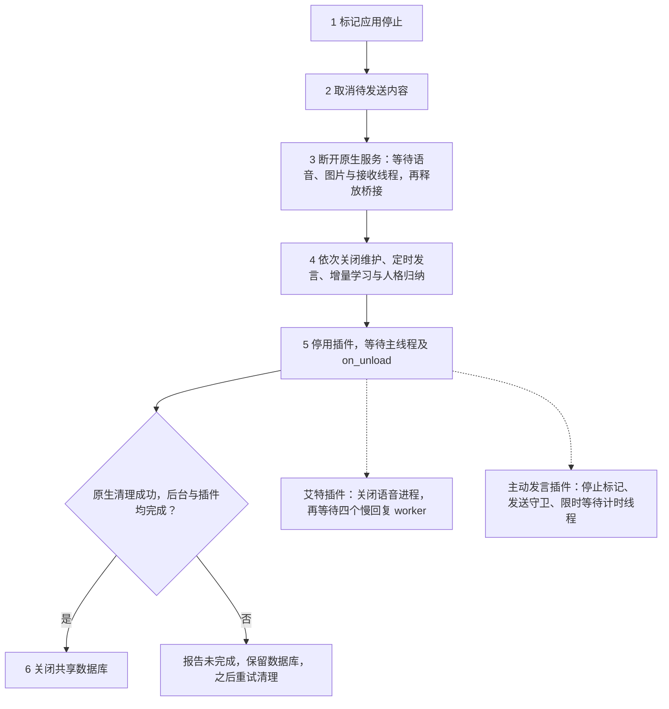

# 启动与退出

## 职责

主循环、连接监督、动态设置与本地控制台。装配与显式初始化在 `app/bootstrap.py`。

<!-- diagram: ../../docs/diagrams/shutdown-threads.mmd -->

原生断开阶段先停止媒体任务与接收线程，再释放通道及桥接；插件阶段由各插件释放私有资源。具体线程与所有者见 [架构资源归属](../architecture/spec.md#资源归属)。

## 必须成立的规则

| 编号 | 规则 | 失败行为 |
|---|---|---|
| 1 | 启动顺序固定：建库与自愈 → 本地资料修订 → 知识种子 → 群状态 → 启动公告与问候（公告优先）。 | — |
| 2 | 只有显式启动会写数据库；`--check` 与 `--list-plugins` 不建库、不注入微信、不请求模型。 | — |
| 3 | 启动公告或问候失败不影响微信连接；同一运行内重连不重复发送已成功的公告，也不重复问候。 | — |
| 4 | 断线后按 `reconnect_seconds` 重连；重连会取消旧会话的待发回复。 | — |
| 5 | 停止顺序固定：标记停止 → 取消发送 → 断开并清理原生桥接 → 等待维护、后台与记忆线程 → 停用并等待插件 → 关闭数据库。 | 原生清理失败：抛 `RuntimeError`，提示运行 `python tools/recover_bridge.py`，数据库保持打开。 |
| 6 | 退出确认：维护、记忆或定时发言的 `close()` 报错、插件主线程仍在执行回调或 `on_unload`、或原生清理失败时，报告停止未完成，**不主动关闭数据库**；释放阻塞后再次调用停止流程可完成收尾。插件私有线程的等待由各自 `on_unload` 负责。 | 后台任务未退出：抛 `RuntimeError` 列出未完成的名称，数据库保持打开。 |
| 7 | 已退出的插件记录被移除，再次停止不重复执行卸载；超时未退出的记录保留，再次停止时继续等待并可完成收尾。 | 停止期间再次收到中断：只提示等待，不重复进入清理。 |
| 8 | 忙碌插件仍拒绝被热重载覆盖；插件可用 `has_pending_callbacks()` 报告主回调之外未完成的任务，并在 `on_unload` 等待自建线程退出。 | — |
| 9 | 通用原生服务停止时，先取消排队语音并等待当前转写，再等待图片下载，最后等待接收线程、关闭原生通道并卸载桥接。 | 图片下载或接收线程等待超时：保留桥接，交规则 6 报告未完成。 |
| 10 | 艾特回复插件卸载先关闭本地语音子进程，再关闭四个慢回复 worker；人格归纳由 `MemoryWorker.close()` 与增量学习一起等待。 | 慢回复未退出时插件主线程仍停在 `on_unload`，交规则 6 处理。 |
| 11 | 档案插件独立持有四个慢回复 worker；卸载先停止并等待队列，再清空短期人物确认。等待模型期间不持数据库锁，发送复核上下文、人格、连接及停止标志。 | 忙碌状态拒绝热重载；关闭后不发送剩余档案段落。 |

## 验收

- `tests/test_lifecycle.py`：阻塞插件导致停止未完成且数据库仍打开；放行后再次停止才关闭数据库，
  卸载只执行一次；原生清理失败同样不关库。
- `tests/test_bridge_recovery.py`：清理顺序、失败不跳过其他 worker、中断处理与恢复。
- `tests/test_framework.py`：重连、退出与控制台命令。
