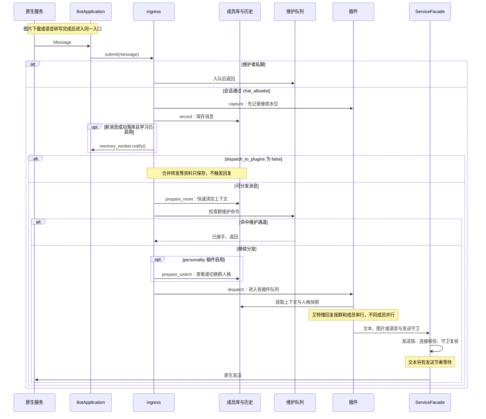

# 消息接收

## 职责

把一条收到的消息按固定顺序交给成员库、维护通道与插件。这里不做业务判断，
也不决定回复内容。

<!-- diagram: ../../docs/diagrams/message-flow.mmd -->

图中包含维护分流、仅记录资料、群人格切换与统一发送入口；原生层先完成图片下载或语音转写，再进入 `ingress`。

## 必须成立的规则

| 编号 | 规则 | 失败行为 |
|---|---|---|
| 1 | 顺序固定，逐段可读：维护者私聊分流 → `chat_allowlist` 过滤 → `capture` → 落库与学习通知 → 检查 `dispatch_to_plugins` → 快速上下文清空 → 群维护分流 → 人格插件启用时执行 `prepare_switch` → 插件分发。人格查看与切换沿用同一群状态，切换立即使旧人格回复失效。 | 维护者私聊命中管理通道：进入维护队列后直接返回；仅记录的资料在落库后停止；群维护未命中：继续后续分发，不重复回复。 |
| 2 | `capture` 先于落库：落库慢时，发题水位仍能排除“已经收到但尚未入队”的答案。 | — |
| 3 | 落库失败只记录日志，消息继续分发到插件。 | 落库异常：`logger.exception` 记录，分发继续。 |
| 4 | 同一条消息的所有插件拿到同一份群状态快照；已捕获的空状态不会被后来的游戏状态替换。 | — |
| 5 | 唯一维护者的私聊是管理通道，不要求把该会话加入群收发名单。 | — |
| 6 | 接收水位按群记录：原生序号重置不影响进程内序号，插件重载保留 epoch，进程重启更换 epoch。 | — |

## 图片消息（type = 3）

图片事件走与文本相同的分发顺序。原生服务解析图片 XML 后交给账号专属的异步接收器，
下载完成才把事件投递给插件；插件不需要接触 XML、CDN 或原生下载接口。

| 字段 | 含义 |
|---|---|
| `type` | `3`，`Message.is_image` 为真 |
| `text` / `msg` / `content` | 空字符串；图片没有可展示正文 |
| `image_status` | 投递时为 `ready`、`failed` 或 `skipped` |
| `image_path` | `ready` 时为已保存图片的本地绝对路径，其余为空 |
| `image_error` | `failed` / `skipped` 的原因；不包含 XML、CDN 地址或密钥 |
| `image_quality` | `standard`、`original`、`thumbnail` 或 `unknown`；`ready` 时记录实际保存的画质 |
| `image_metadata` | 公开字段：`md5`、`width`、`height`、`length`、`hdlength`、`cdnthumbwidth`、`cdnthumbheight`、`cdnthumblength`、`cdnmidwidth`、`cdnmidheight`、`encryver` |

状态语义：

- `ready`：图片已下载、校验并保存在当前账号目录，`image_path` 可直接读取。优先下载原图，失败且有普通图引用时改试普通图；只有普通图引用时直接下载普通图。
- `failed`：没有候选图片可成功下载并保存，`image_path` 为空；不重新入队，可观察原因在 `image_error`。
- `skipped`：不在支持范围，未发起下载。包括会话不在图片名单、消息只有缩略图引用（`cdnthumbaeskey` 不被原生下载接口接受）、以及密钥格式不符合原生接口要求。

公开边界：

- 原始图片 XML（`raw_content`）只在解析和下载请求内部使用，解析后立即从事件中移除；插件拿不到 XML、CDN 地址、`filekey` 或密钥。
- 图片事件只在已编译桥接同时导出 V4 媒体队列与 `WxDownloadImage` 时产生；否则后端不声明图片能力，依赖它的插件不会启用。
- 4.1.15.13 和 4.2.0.12 的配套桥接均保留本项目 V4 接收布局，按构建识别账号和联系人；插件接收相同的消息字段。
- 只处理启动后实时到达的图片，不补抓历史；接收层不识别图片内容，识别只在艾特回复里按需进行（见 [mention-reply](../mention-reply/spec.md) 规则 12）。

最近图片索引（`wxbot_framework/recent_images.py`）：

- 原生服务在图片进入下载队列时记一条 `pending`（带原消息编号、发送者与图片 md5），下载结束后更新为 `ready` / `failed` / `skipped`；写入发生在插件分发队列之外，正在生成的艾特回复不会挡住记录。
- 只保存会话、发送者、状态、本地路径、md5 与原消息编号，不保存 XML、CDN 地址或密钥；进程内按群有界（每群 64 条、至多 256 个群），服务启动时清空，插件热重载不影响。
- 记录带“已看过”标记：艾特回复看图成功后标记，之后不再按“刚发的图”选中，按引用仍能找到。按“刚发的图”查找时可选自己发的或别人发的（`from_others`）。
- 引用消息解析出的 `quote` 在被引用的是图片（`ref_type=3`）时额外带 `svrid` 与 `image_md5`，供艾特回复对上索引；不带缩略图 md5、密钥或 CDN 地址。

## 群语音（微信类型 34）

对已启用记录且在收发范围内的群，微信 4.2.0.12 的配套桥接优先接收消息自带的完整 SILK。音频未随消息送达时，桥接按 64 位原消息编号关联微信已保存的消息对象，并提交微信自己的语音下载任务。任务收到完整音频后仍经 `WxPollMediaMessageWithVoice` 投递。下载与本机识别均独立于文字接收。

识别结果以原发言者的名义进入聊天记录和插件上下文，保留原始语音编号供引用定位。优先使用转写正文；没有文字时，可以记录模型识别到的咳嗽、笑声等常见声音。机器人不把音频落盘，也不主动在群里发转写。缺少模型、音频不全或没有有效识别结果时跳过该语音。

## 合并转发（微信类型 49，卡片类型 19）

群内实时收到的卡片含内嵌记录时，读取文字、原署名和原时间。整张卡片以转发者名下的一条资料进入聊天记录，不拆成群友实时发言，不参与个人长期学习，也不触发插件指令或自动回复。引用按原始消息编号取同群保存的资料。图片、语音、文件和嵌套卡片不展开。

## 验收

- `tests/test_idiom_ordering.py`：capture 幂等、水位按群记录、原生序号重置与插件重载后的水位。
- `tests/test_framework.py`：allowlist 过滤、维护者私聊分流、插件分发顺序。
- `tests/test_image_receiver.py`：ready/failed/skipped 投递、队列与下载失败可观察、事件不含 XML 与密钥。
- `tests/test_mention_tools.py`：最近图片索引的记录、更新与有界；引用图片字段不泄露密钥或 CDN 地址；入队时记 pending 并带 md5，日志不含路径。
