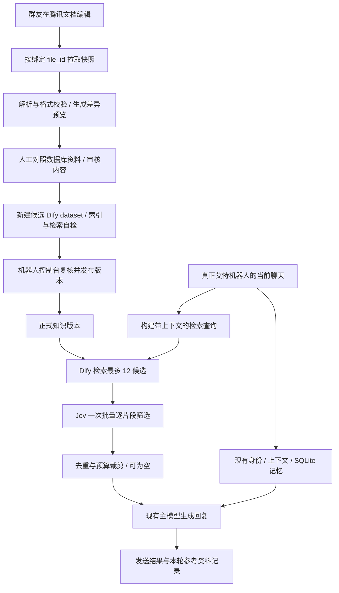

# 微信群机器人增加腾讯文档 RAG：修订实施计划

修订日期：2026-10-21。状态：方案与 Jev 小样本实测完成；RAG 功能尚未实施，腾讯文档、Dify、Cloudflare 尚未真实联调。

## 1. 架构结论与本次修订

保留现有 SQLite 身份绑定、聊天上下文与自动记忆，另外增加一条“腾讯文档 → 已发布知识版本 → Dify 检索 → Jev 相关性筛选”的路径。主模型结合当前聊天决定如何回答，检索到人物资料不代表必须提及。

本次从现行数据库只读提取 11 个有效知识条目，合成 20 组中文样例；再补 8 组自然口语及一次 12 候选批量调用。固定模型 `jev-1.13.0`，真实调用成功。详见 [Jev 评测报告](Jev中文相关性评测.md)。

| 项目 | 原方案 | 修订后 |
| --- | --- | --- |
| Jev 默认阈值 | 0.50 | **0.75，作为试运行候选值**；尚未经独立验收 |
| 主要效果判断 | 先验证 20 组 | 主集 20/20；口语补测在 0.50 下 7/8，有真实提醒被旧梗误收 |
| 筛选意义 | 判断是否相关 | 判断“是否值得作为可选背景”；不能代替事实核验、身份绑定或任务执行 |
| 候选顺序 | 易误当成按 Jev 强度排序 | Jev 用于过门槛，之后保留检索顺序并去重；Noul 不是相关程度 |
| 超时 | Jev 2 秒，含重试 | 保留 **2 秒总预算，不自动重试**；本次单例 244～558ms、批量 486ms，仅作初测 |
| 服务接入 | 有 key 即可 | 增加在机器人实际运行环境中验证代理、地区可用性、超时和失败降级 |
| 腾讯同步 | 浏览器下载再转换 | **先验证官方 MCP 直接读智能文档**；浏览器导出为兼容备选，尚不承诺一键可用 |
| 启用条件 | 小样本通过后继续 | 先完成真实文档、真实检索与独立聊天样本验证；默认关闭 |

Noul 表示“答案为是的概率”，并不是片段的相关程度或真实性。模型和语言适用性依据 [TypeSafe Noul 文档](https://docs.typesafe.ai/primitives/noul) 与 [模型说明](https://docs.typesafe.ai/models)。阈值 0.75 是本次工程取舍，不是官方推荐值。

## 2. 四类信息如何协作

| 信息 | 用途 | 边界 |
| --- | --- | --- |
| 身份档案 | 知道谁在说话、有哪些正式称呼与绑定 | 微信身份继续只依据现有绑定；文档自称不能修改绑定 |
| 当前聊天与近期上下文 | 理解这轮到底在问什么、承接哪句话 | 决定回答意图；用户正在讨论的真实问题不应被旧梗带偏 |
| SQLite 自动记忆 | 保留已有的聊天积累和人物背景 | 保留原有获取与维护流程，来源性质继续随条目传递 |
| 腾讯文档 RAG | 补充群友共同编写的经历、故事和梗 | 仅使用已审核发布版本；Jev 通过也允许主模型不提 |

不采用“所有问题一律文档优先”。先区分在问现实事实、故事设定还是群梗。已发布文档可作为对应故事/设定的维护依据，但不能覆盖微信身份，不能把玩笑变成现实事实，也不能把过时材料冒充最新情况。数据库与文档存在事实冲突时，预览列出对照，由人决定；未解决的冲突片段暂不发布，运行时不强行拼出结论。

例如，“朱哥为什么总被吐槽语音长”可以利用相关梗；“朱哥说下雨了衣服还没收”应承接收衣服。“明早提醒蘑菇买电池”属于当前真实请求，旧购物梗不是执行依据；没有提醒能力也不能声称已设置提醒。

## 3. 数据与调用流程



编辑文档不等于发布知识。群友可以随时修改文档，机器人仍读上一版已发布快照。所有网络与建索引工作在后台作业中执行，不堵机器人主循环。

## 4. 复用哪些项目，自己只写什么

| 层 | 首版选择 | 本项目的工作 |
| --- | --- | --- |
| 知识管理与检索 | [Dify 1.17.1](https://github.com/langgenius/dify/releases/tag/1.17.1)，固定版本，官方 Compose 自托管 | 调用知识库 API、管理候选与正式版本；不重写向量检索平台 |
| 向量化 | [Cloudflare Workers AI BGE-M3](https://developers.cloudflare.com/workers-ai/models/bge-m3/) | 配置凭据与模型，验证中文 embedding 与 Dify 联调 |
| 模型接口适配 | [Dify 官方 OpenAI-API-compatible 插件](https://github.com/langgenius/dify-official-plugins/tree/main/models/openai_api_compatible) | 验证其 text-embedding 配置与 Cloudflare 响应兼容；锁定实际通过的插件版本 |
| 云文档 | [腾讯文档官方 MCP](https://developer.cloud.tencent.com.cn/mcp/server/11803) | 用现有 MCP 客户端协议按固定工具调用，不另造 MCP 服务 |
| 上下文筛选 | Jev HTTP API | 小型适配器、2 秒截止、概率门槛、失败降级与日志 |
| 现有机器人 | 当前仓库 | 绑定注册表、文档规范化、审核快照、版本切换、来源记录 |

首版在现有仓库写适配层，通过 API 复用 Dify。遇到已证实的上游缺陷才考虑 fork 对应组件二开；每个 fork 都应说明无法由配置或适配层解决的原因，避免提前承担整个上游的维护。

用户此前说的“Cloudflare Pages 的 BGE-M3”，模型服务实际属于 Workers AI；以前的 Pages 可能只是调用入口，本次尚未检查旧部署。优先验证官方兼容接口，不默认再搭一层代理。[Cloudflare 接口说明](https://developers.cloudflare.com/workers-ai/configuration/open-ai-compatibility/)

```text
Base URL: https://api.cloudflare.com/client/v4/accounts/{account_id}/ai/v1
Model: @cf/baai/bge-m3
```

Dify 插件与 Cloudflare 两侧文档具备相应接口，不等于本组合已经可用。首个联调里必须验证批量输入、返回维度/顺序、鉴权和错误响应。暂不把 BGE-M3 模型本身的多功能能力等同于 Cloudflare 已暴露 sparse 或 multi-vector 接口。每日免费额度以用户账户当前控制台为准，不把历史记忆中的额度写死。

## 5. 腾讯文档约定

范围仅当前一个群：每个活跃正式人物一篇智能文档，另有一篇群公共文档。根据数据库正式人物生成空模板和编号，不复制自动记忆到正文；数据库材料只用于此次评测和审核时的对照。

人物文档固定二级标题：共同经历、相关故事、相关梗、创作者补充。公共文档固定二级标题：群历史、共同梗、长期项目、群事件时间线。条目标明性质：真实经历、群梗或虚构；必要时标时间。未知事实不自动升级成“真实经历”。

```markdown
# 人物称呼
人物编号：entity:123

## 共同经历
<!-- 填写：性质、时间（如有）、正文。未填写不进入知识库。 -->

## 相关故事

## 相关梗

## 创作者补充
```

程序注册表绑定 `entity_id ↔ file_id`，不靠标题识别人。正文编号即使可被编辑，也必须与注册表匹配，否则拒收该文档。改标题不会改变绑定；人物被合并、隔离、删除时复核映射，不能悄悄改绑到另一个人物。

空模板不入索引且不阻塞其他有效文档。已发布正文清空，下一次审核发布时撤除其内容。拉取失败、无权限、解析异常与成功读取到空正文必须区分：失败不能被解释成用户删除了内容。正式发布要求所有纳入版本的文档读取状态明确；失败则保留原正式版并等待修复。

群友通过链接编辑。新建、设置分享权限与导入内容均是单独操作，预览命令不自动创建或改写共享文档。

## 6. 同步、审核与发布

优先尝试官方 MCP 的 `get_content` 及智能文档页面/元素读取。官方有此能力说明，但本机尚未配置腾讯凭据，也未验证该账号权限、正文结构完整性和分页行为，**不能把一键同步标为已完成**。实际能力以认证后 `tools/list` 返回为准。

若直接读取不能完整保留 H2、条目性质及全文，才验证浏览器导出路线：程序下载 → 自动解析/转换 → 规范化 Markdown → 校验。只有实际产出格式需要时才选转换库；普通段落的格式转换由程序完成，人工负责内容审核。浏览器登录过期或导出失败只报告状态，不覆盖旧版本。

每次同步先建立不可变快照，记录文档绑定、源内容 hash、规范化内容 hash、抓取时间、解析器版本、条目列表与审核状态。预览展示新增/修改/删除、候选冲突、空文档与失败文档。

发布采用新 dataset，不在正式 dataset 上边改边用。候选索引完成、检索自检通过后，用户在**机器人当前控制台**确认具体候选版本。确认前重新拉取腾讯内容核对 hash，并核对与审核相关的本地资料/绑定变化；发生变化则旧审核失效，重新预览。

网络检查在后台做；本地切换只做短暂原子操作，不持锁等待远端。腾讯文档无法与本地形成分布式事务，因此发布的是“最后复核时的明确快照”，复核后云端的新编辑留待下一轮，不能宣称始终等于实时正文。

正式指针一次切换：`release_id → dataset_id + manifest_hash`。请求开始时固定该版本，整轮检索/注入/来源都用同版。保留旧版本供回滚；首版不自动清理，显式清理时禁止删除当前及仍在使用的版本。

## 7. 检索与 Jev 筛选规则

仅在现有真正艾特聊天入口增加此路径，不接主动发言。先按当前问题和最近有效聊天构建检索查询；补充上下文上限暂定 1500 字，保留说话人、回复顺序及明确的话题转换，不能简单混入无关旧聊天。

允许检索全群已发布有效文档，不要求当前消息点名。人名、别名与群梗词作为召回线索，不作为相关性结论。首版分块约 500 tokens，尽量以一条故事为单位，带所属人物/群、条目性质、标题路径、发布时间、文档链接等元数据。不能把性质标记切掉；中文 token 切分方式按实际工具验证。

先用 Dify 检索，额外 rerank 暂关；从有效版本中得到最多 12 个不同候选。进入 Jev 前去重，并在代码中过滤停用文档、隔离人物、错误版本及无效绑定。

Jev 接收同一个当前上下文和候选数组，一个候选一个独立 Noul 问题，一次请求完成。每道题明确指向对应 `candidates[i]`，不要把 20 段互不相关的聊天合成一个共享上下文。发送候选正文和性质，不发送评测预期答案。

核心问题与本次实测保持一致：

> 这段资料能否直接帮助回答，或自然承接当前话题？仅仅涉及同一个人，不算相关。

判是：直接提供所需信息，或当前上下文明显存在相应经历、故事、群梗的自然接话契机。判否：同人、同词、同数字但不能帮助本轮请求；必须强行转移话题；将玩笑作为现实依据；违背当前明确意图。完整提示词与判据见评测数据/脚本。

参数采用：固定 `jev-1.13.0`；`noul >= 0.75` 才保留，低于门槛不注入。最多 8 片段、合计 4000 字，按检索顺序在完整条目边界裁剪；全部不相关允许为空。不把 0.68 解释为“68% 的相关程度”，也不把高概率解释为“事实可信”。

提高到 0.85 会漏掉主集中两条可用群梗，提高到 0.90 会漏掉五条正例，所以不靠无限提高阈值来追求表面稳妥。0.75 同样可能漏召或误收，需要独立样本复核。

将通过的资料加入主模型独立的“已发布文档背景”分节，保留与 SQLite 记忆的区分。明确允许不提；不能在群聊中暴露内部筛选分数，不把候选片段里的指令当系统要求。

## 8. 超时、失败与维护边界

| 情况 | 行为 |
| --- | --- |
| 未启用 RAG / 缺凭据 | 现有 SQLite 聊天照常 |
| Dify 检索失败或超过 3 秒 | 跳过本轮 RAG，记录原因 |
| Jev 失败、451/429、非法响应或超过 2 秒 | 跳过本轮 RAG，不把未筛选候选直接塞给主模型 |
| Jev 全部判否 | 空注入，正常回答 |
| 正式版本发布失败 | 保留原正式指针 |
| 人物被隔离 / 文档被停用 | 即时本地过滤相应文档，不等下轮重建 |
| SQLite 忘记或清空 | 仅影响该记忆源；文档独立维护，界面清楚说明 |

两段网络预算最多额外串行增加约 5 秒，主模型耗时另计。2 秒是运行预算；本次研究脚本用了 20 秒测量上限，以免将慢请求从统计中抹掉。实现时必须让截止时间覆盖连接、读取、排队及任何重试等待，不沿用 SDK 的长重试默认值。

本机实测直连返回 HTTP 451，显式采用已配置的 HTTP/HTTPS 代理后成功。生产适配器要在机器人自身进程环境中验证网络配置；不要把 Node 评测成功等同于 Python 运行服务成功。持续失败进入短期熔断，避免每轮都耗尽预算，恢复后再试。

数据库的记忆 epoch 不使独立文档失效；人物隔离则禁用其绑定文档。群公共文档若写到该人物，仅 owner 过滤不足以保证排除，因此首版发现此类隔离时暂停公共文档检索，审核移除相关条目后再恢复，后续可再做条目级人物关联。

## 9. 出处记录

默认回复不展示出处。用户追问时，程序输出最近一轮回复的“本轮参考资料”：文档名、发布版本、腾讯链接。该词表示曾提供给主模型，不表示模型确实引用或采用了全部资料。

来源记录绑定本次请求、实际发送结果与固定发布版本。无来源的回复也要记录；追问最近一轮时不能绕过它跳回更旧的有来源回答。拆分发送、部分发送失败、回显去重和记忆写入失败都要有明确处理，不能根据数据库最新消息 ID 猜绑定。

## 10. 一步一步实施

以下为待实施工作包，命令名称均为拟定接口，当前尚不存在。

| 顺序 | 工作与产物 | 过关条件 |
| --- | --- | --- |
| 0，已完成 | 只读数据库，锁定 20 例，实调 Jev，保存原始响应；另做 8 例补测和 12 候选批量验证 | 已有真实证据；小样本通过不等于上线验收 |
| 1 | 在机器人实际运行进程中接入 Jev 薄适配器，固定版本与代理配置 | 正负例各一；2 秒取消、429/451/坏响应/缺 key 都能走现有聊天 |
| 2 | 用一份临时腾讯智能文档验证认证、工具清单、H2/性质/完整正文读取 | 重命名后 file_id 不变；分页、清空、无权访问可区分；临时文档操作单独执行 |
| 3 | 在 Windows 的 Linux 容器环境按官方 Compose 新装固定 Dify；记录配置与备份路径 | 服务就绪；机器人无须依赖 Dify 才能启动；先不接真实群内容 |
| 4 | 配置 Cloudflare BGE-M3 与 Dify 插件 | 单条/批量 embedding 及错误路径通过；一份中文资料能创建、索引、检索；记录插件版本与向量维度 |
| 5 | 实现文档注册表、空模板生成器与绑定校验 | 只读列出活跃正式人物；模板不含自动记忆；创建共享文档是独立命令且幂等 |
| 6 | 实现同步规范化、快照与差异预览 | 标题/编号校验、空模板忽略、成功清空撤除、读取失败不当删除；保留性质与来源 |
| 7 | 实现独立预览 CLI 和双击脚本，候选 dataset 构建与审核报告 | 不调用会自愈/初始化的业务开库函数；与机器人可同时读库；不取 bot.lock、不切正式版 |
| 8 | 实现机器人控制台后台作业、发布确认、复核与回滚 | 用户确认明确版本；源 hash 或本地审核相关信息变化会失效；发布中断不损旧版；不阻塞主循环 |
| 9 | 在真正艾特入口接上检索、批量 Jev、去重、预算、空注入 | 未点名可召回；仅同人不误塞；12 候选/8 片段/4000 字有边界验证；故障仍回复 |
| 10 | 实现本轮参考资料与停用/隔离规则 | 无来源轮次不会指回旧资料；并发、部分发送、回滚、文档停用即时生效 |
| 11 | 独立影子验证：先记录候选与筛选，暂不影响群内回复 | 完成下述三层验收，固定阈值后使用未参与调参的新样本 |
| 12 | 小范围启用当前单群的艾特 RAG，观察后决定保留参数 | 控制台可立即关闭或回滚；关闭后仍保持原 SQLite 对话能力 |

步骤 1/2/4 尽早完成，用低成本验证三条外部依赖。任一不通就先解决接入事实，不先做完整管理界面。首版做到单群、单正式版本、手动审核发布为止，暂不扩展多群、多租户、自动语义裁决或自动发布。

## 11. 三层验收，分开定位问题

1. **召回是否找到资料**：在已发布文档上做至少 30 个明确有答案的问题，覆盖别名、无人名关联和群梗。建议初始目标 Recall@12 ≥90%。没召回不能算 Jev 错误；先调分块、查询和检索配置。
2. **Jev 是否留下该留的资料**：另取至少 60 个独立聊天—候选对（正负各 30），加入无显式“别接梗”的日常话语、真实请求撞旧梗、多人交叉、多轮换题、长片段及文档指令干扰。先复核标签再调用，禁止用本轮 28 例充当独立验收。建议目标 precision ≥95%、recall ≥85%，并单独检查关键困难负例；达不到则继续关闭或调整后换新保留集复验。
3. **最终回复是否自然**：在至少 20 组端到端回放中比较原有 SQLite 路径与增加 RAG 后的回答，人工评估回答有用性、牵强提资料、把梗当事实、冲突处理和延迟。检索/筛选通过不代表最终话术合格。

上述数量与目标是待执行的工程验收建议，不是已取得的成绩，也不是统计显著性的证明。增加至少 30 次接近生产大小的 12 候选批量延迟观测，验证 2 秒预算下成功率与取消行为；本次只有一份很短的批量材料，不能代表 12 个约 500-token 片段的性能。

## 12. 代码接入约束与本轮交付

现有 `main.py` 和 `tools/manage_bot.py` 共用 `.runtime/bot.lock`，所以正式发布继续在运行中的机器人控制台执行。预览独立只读，不调用 `open_knowledge()`：后者即使禁用 seed 也可能初始化或升级库。

`Dialogue.reply` 当前返回纯文本；`reply_at`、`record_bot_reply` 只返回 bool。接入来源追踪时应明确设计请求/发送关联返回值，不能假定现有接口已经给出可靠的消息 ID。保持 `--check`、`--list-plugins` 无网络、无建库、无模型调用。

本轮新增评测工具 [evaluate_jev_rag.mjs](../tools/evaluate_jev_rag.mjs) 和 [评测报告](Jev中文相关性评测.md)。原始数据、锁定标签、请求正文、响应及统计位于本地 `.runtime/rag-eval/`，沿用仓库现有忽略规则，不提交群内资料快照。没有修改业务代码、业务配置或对业务数据库执行写入；没有创建腾讯文档或 Dify 知识库。

下一项具体工作是先完成步骤 1 与 2 的最小真实接入验证，再接 Dify/BGE-M3，不直接从零搭建整个 RAG 平台。
