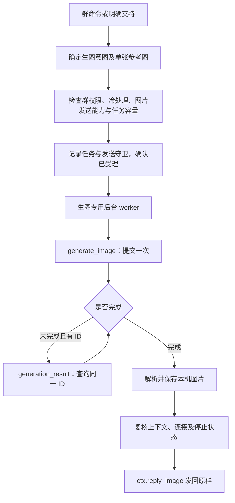

# 生图功能调研与设计

日期：2026-11-17。状态：已实施，离线验证与真实模型、原生微信发送实测通过。

## 1. 目标与已确认决定

让现有微信群机器人接受画图请求，经本机 Magpie MCP 生成图片，再直接发送微信群图片消息。

用户已确认：

- 生图接口使用 Magpie MCP，模型已在 Magpie 配好。
- 第一版支持 `/生图 描述` 与明确艾特机器人的自然语言画图请求。
- 调研设计确认后实施、实测、重启、公告、提交并推送。

实施范围包含单张参考图编辑，同时生成一项、最多等待两项，受理后总等待上限五分钟。

## 2. 已核实的接入条件

2026-11-17 在本机执行 `magpie --version`、`magpie tools generate_image`、`magpie tools generation_result`、`magpie status --json`，并向实际 MCP 端点执行 `initialize` 和 `tools/list`。这些操作未提交生图任务。

| 项目 | 核实结果 |
| --- | --- |
| 运行服务 | Magpie `0.1.4354`，`http://127.0.0.1:3425` |
| MCP 端点 | `/mcp/magpie/image` |
| 协商协议 | 请求及返回均为 `2025-03-26` |
| 服务能力 | `capabilities: {tools: {}}`；提供 `generate_image`、`generation_result` 和视频工具 |
| 当前默认生图模型 | `openai/gpt-image-2.6-sunburst`，由本机工具描述返回 |
| 提交参数 | `prompt` 必填；`reference_images`、`n`、`size`、`quality`、`background`、`complexity`、`model` 可选 |
| 默认模型 | 省略 `model` 即使用 Magpie 当前选择；Bot 无需保存供应商密钥或模型清单 |
| 张数与参考图 | `n` 为 1–4；参考图接受 URL、data URL，或 Magpie 同机的绝对文件路径 |
| 长耗时行为 | 工具描述约定：约 20 秒内未完成则返回任务 ID；用 `generation_result(id)` 等待，每次约 20 秒内返回，未完成继续查询同一 ID |
| 图片结果 | 工具描述约定：回复内含图片，并提供一小时有效的下载 URL；Magpie 不替调用方保存到项目 |
| 输出结构 | 实测处理中 ID 在 `_meta["usemagpie.ai/pending"]`；完成结果含标准 `image` 内容块，下载信息在 `_meta["usemagpie.ai/files"]` |

**证据范围：**端点、版本、参数与实际生图结果均已核实；已观察约 20 秒返回任务 ID。两轮模型生成、图片落盘与原生微信发送完成回执通过，图片内容经人工视觉检查符合要求。一小时链接有效期来自工具声明；未做独立收件端 UI 验证或费用测量。

MCP `2025-03-26` 标准支持 `content[]` 中的 `image` 块，字段为 base64 `data` 和 `mimeType`。Magpie 的任务 ID 与下载 URL 属于工具层约定，按真实响应解析。协议来源：[MCP 工具规范](https://modelcontextprotocol.io/specification/2025-03-26/server/tools)。

## 3. 交互设计

| 场景 | 行为 |
| --- | --- |
| `/生图 一只戴宇航员头盔的橘猫` | 直接受理，跳过意图判断 |
| `@机器人 帮我画一只水彩风格的猫` | 确认本轮确实要求生成图片后受理 |
| `@机器人 怎么画猫？`、`@机器人 这张图好看吗？` | 沿用文字回答或看图流程 |
| `/生图` 无正文 | 给一句用法，不提交任务 |
| 引用一张已收录图片，发送 `/生图 把背景改成雪山` | 将该图片作为单张参考图传入 |
| 明确说“改这张图”，未引用 | 只在本人前 120 秒内存在唯一可用图片时选中；多个候选或没有候选时请其引用或重发 |
| 正文明确要求新画一张，附近恰有图片 | 按文生图处理，不自行附带参考图 |
| 成功受理 | 一句短文字确认；排队时说明排队状态 |
| 生成完成 | 在原群艾特请求者并发送一张真实图片 |
| 无法完成 | 简短说明服务失败、等待超时、参考图缺失或发图失败，按实际阶段给出结果 |

范围沿用现有已启用群和群成员权限。普通群聊不自动触发生图。每次一张，尺寸及质量交给 Magpie 默认值，用户构图要求保留在提示词中。

提示词直接保留用户正文；中文、图片中需要呈现的原文和明确风格均原样传递。第一版不强制增加一次聊天模型扩写调用。

自然语言入口复用 Jev 判断模式，判断的是“本条明确艾特是否要求生成或编辑图片”。命令入口独立可用；Jev 不可用时不发起自然语言生图，按普通聊天处理。生图意图阈值 0.8、参考图需求阈值 0.7，12 条真实 Jev 正反例全部符合预期。

## 4. 方案选择

交互方案中，用户已选择“命令＋明确艾特请求”。只用命令更易实现，但减少自然表达入口；普通聊天主动配图会增加调用次数及误触发机会，当前不纳入已确认范围。

实现方案推荐复用 `mention_chat` 的入口和生命周期，拆出 `image_reply.py` 管理生图。现有 `voice_reply.py` 已采用同类拆分。

| 实现位置 | 取舍 |
| --- | --- |
| **现有艾特插件＋独立生图模块，推荐** | 命令和艾特请求共用归属、冷处理、上下文守卫；可明确结束当前文字回复路径 |
| 新建独立生图插件 | 命令功能很清楚；自然语言入口还需要处理与艾特插件同时响应的问题 |
| 把生图接入现有看图/搜索工具流程 | 入口相近，但现有工具流程限定 60 秒并返回文字供聊天模型回答；生图需要独立等待和媒体发送 |

## 5. 请求执行流程

后台任务由 `mention_chat` 拥有，生图等待不占用现有四个聊天 worker。入口认领成功后，当前消息结束普通文本/语音生成，后续群聊正常处理。生图任务在入队时固定正文、参考图和请求者；后续补充文字不暗中修改已经提交的任务。

**消息归属接线：**当前 `_advance_turn()` 会把同一成员后来发出的真实艾特合并进上一轮，`_process_message()` 会跳过已合并消息。生图意图判断必须同时覆盖“补话合并前”与“本条消息处理入口”，按接收消息身份复用判断结果。已识别的生图消息保留独立身份，不参与上一轮合并；合并检查处不提交生图，提交只发生在该消息自己的受理路径。`ConversationTurns.claim()` 当前只标记认领，单独调用它无法排除补话合并。非生图消息保持现有合并行为。

**去重归属：**`ImageReply` 独立持有排队至最终投递的去重记录，受理回执不结束记录。沿用现有 `_claim()` 对到达时刻与完成时刻的判断原则，过滤在首次任务结束前已到达、后来才从聊天队列取出的相同请求。容量检查与请求去重分别执行；提交结果未知、落盘失败及发图失败保留失败阶段，不能因普通文字流程的 `_release(delivered=False)` 再提交一次。任务结束后用户新发的明确请求视为新请求。

当前限制：全 Bot 同时生成 1 个任务、最多等待 2 个任务；同群同一成员同时只保留 1 个任务。容量满时先提示忙碌，不调用 Magpie。

每个 MCP 请求上限为 35 秒，整项任务从受理起上限为 5 分钟，含排队、查询及图片落盘。查询使用剩余预算；超时后不重复提交。本次两轮实测分别约 62 秒、37 秒，均在预算内完成。

Magpie 返回 ID 后继续调用 `generation_result`；无需通用 MCP Tasks、额外调度服务或启动子进程。每次查询本身已有等待，服务正常等待时直接续查；若服务立即返回未完成，用短暂可中断等待避免空转。

## 6. 图片结果与生命周期

- `_McpEndpoint.call()` 保留原有文字接口；新增 `call_raw()` 保留图片及任务元数据，供独立生图适配使用。看图/搜索保留原 2 MiB 响应预算及超时范围。
- 取得标准 `image` 块时解码落盘；若实际结果仅给下载 URL，则从 Magpie 返回的地址取图。用户文本和聊天模型生成的 URL 不作为结果地址。
- 结果大小沿用 `images.py` 的单图 20 MiB 上限；生图端点响应预算建议 32 MiB，覆盖单张图的 base64 开销，原看图/搜索预算保持原值。图片签名沿用现有检测函数。
- 生成图保存到 `.runtime/generated_images/`，以内部任务编号命名，按真实图片格式确定扩展名。首版保留文件，不增加自动删除流程。
- 引用图通过 `recent_images.py` 查本群消息编号，使用已下载的本机路径；待下载图沿用现有短时等待。未找到引用时不改用另一张图片。首版参考图范围是已收录的群图片；引用机器人刚生成的图片能否关联原生编号，另由实际接收链路验证后决定。
- 发送统一使用 `ctx.reply_image(message, path, delivery_guard=...)`，复用连接校验和发送锁。守卫覆盖上下文清空、人格变更、冷处理及插件停止。
- 热重载通过 `has_pending_callbacks()` 报告生图任务；卸载停止受理、取消排队和查询等待，并等待专用 worker 收尾。单次网络请求须受硬截止时间约束。只停止本地等待时，不向用户宣称上游生成已经取消。
- 进程重启后不自动恢复旧生图任务。连接变化后旧任务不再向群发送结果。
- 下载失败或微信发图失败时保留已有任务 ID/本机文件和失败阶段；不重新调用 `generate_image`。提交请求失联且未收到 ID 时不自动重交。
- 日志只记录任务编号、阶段和错误类别；群回复不带本机路径、下载链接、密钥或原始接口报错。
- 上游明确返回安全审核拒绝时，独立识别并告知原因与未生成图片；提交和查询阶段均适用，不自动重新提交。

## 7. 实现落点

| 文件 | 职责 |
| --- | --- |
| `plugins/mention_chat/image_reply.py`，新增 | 受理、任务容量、后台生成、失败反馈、发送及卸载 |
| `plugins/mention_chat/__init__.py` | `/生图` 分支，真实艾特入口路由，补话合并前排除生图消息，任务认领和生命周期接线 |
| `wxbot_framework/integrations/magpie_images.py`，新增 | 生图提交、同 ID 查询、结果解析与落盘 |
| `wxbot_framework/integrations/magpie_tools.py` | 最小扩展原始 MCP 结果接口，保留既有看图/搜索行为 |
| `wxbot_framework/conversation/tool_router.py` | 按既有 Jev 模式增加生图意图判断与例子 |
| `wxbot_framework/commands.py` | 命令登记与公开帮助 |
| `README.md`、`使用手册.md`、插件 README | 使用入口、参考图规则和容量说明；复用既有 `magpie_tools.base_url`，无新增配置要求 |
| 对应测试及 `.spec/` | 实现后记录真实行为，更新艾特回复、架构资源归属及生命周期约定 |

配置沿用已有文件，模型、质量与任务容量无群内管理命令。实现行为已写入 `.spec/`，设计与验证记录留在 `docs/`。

本地依据：[`magpie_tools.py`](../wxbot_framework/integrations/magpie_tools.py)、[`PluginContext`](../wxbot_framework/plugin_engine/context.py)、[`mention_chat`](../plugins/mention_chat/__init__.py)、[`SlowReplies`](../wxbot_framework/conversation/slow_replies.py)、[`RecentImages`](../wxbot_framework/recent_images.py)、[架构规范](../.spec/architecture/spec.md)、[发送规范](../.spec/delivery/spec.md)、[生命周期规范](../.spec/lifecycle/spec.md)。

## 8. 实施顺序与验收

1. **取得真实接口样本。** 用单张最小请求确认处理中、完成、工具失败结果的具体结构，确认现有模型接受参考图；保存脱敏契约样本。单次生成完成过快时，不人为伪造“已实测长任务”，继续按工具声明和契约测试覆盖未完成分支。
2. **打通确定性入口。** `/生图` → 提交 → 查询 → 文件 → 发送，补充原始 MCP 解析和专用 worker；验证小图、超过旧 2 MiB 的图、任务 ID 续查和错误分类。
3. **接入自然语言及单张参考图。** 评测“帮我画”“画图的方法”“看看这图”“别给我画”等正反例；成功认领只提交一次，含糊指图先澄清。覆盖同一成员上一轮聊天未结束时发出生图艾特：生图消息不被合并或跳过；等待期间到达的重复请求在稍后出队时也不再次提交。
4. **验证运行边界。** 生图期间其他成员仍可聊天；相同请求不重复生成；队列满不调用；清空、断线、冷处理和卸载阻止迟到发送；发图失败不再生成；原看图、搜索、语音和接龙通过相关回归。
5. **真实入口验收。** 经微信群实际命令和真实艾特各完成一次，验证引用单张图编辑，检查原生发送状态与实际聊天中的图片结果。
6. **正式交付。** 实现通过必要检查并备好公告后，按项目要求执行正常重启 → 公告 `sent` → 提交 → 推送。

## 9. 验证记录

| 验证 | 结果 |
| --- | --- |
| 全量离线测试 | `python -B -m unittest discover -s tests`：876 项通过，含 9 项新增生图契约与入口测试 |
| 安全审核拒绝回归 | 生图测试现为 10 项，全部通过；采用现场错误文本，经本机 HTTP 契约覆盖提交和查询阶段，验证明确反馈、不泄漏原始错误、不重交及不发图 |
| 真实 Jev 意图判断 | 12/12；覆盖画图、改图、绘画方法、看图、否定请求、提示词、模型讨论和转述 |
| 配置与插件入口检查 | `main.py --check`、`--list-plugins` 通过 |
| 命令文生图 | 经 `MessageIngress` 回放 `/生图` 请求，真实 Magpie 生成橘猫宇航员；61.96 秒，PNG 1,820,585 字节 |
| 艾特引用改图 | 经同一入口回放明确艾特及引用，真实模型保留橘猫并将星空改为雪山；36.75 秒，PNG 1,680,375 字节 |
| 微信原生发送 | 两张图均发往配置的维护群，回执 `success=true`、`stage=21`、`completion_success=true`；原生状态为 0 |
| 实测实例退出 | 正常清理，`dll_unloaded=true` |

入口回放使用隔离的聊天数据库，模型与微信发送均为真实调用。实测记录位于本机 `.runtime/image-generation-20261117/`；图片在 `.runtime/generated_images/`。收件端 UI 未单独检查。

外部先例及来源见 [生图功能外部调研](2026-11-17-生图功能外部调研.md)。
