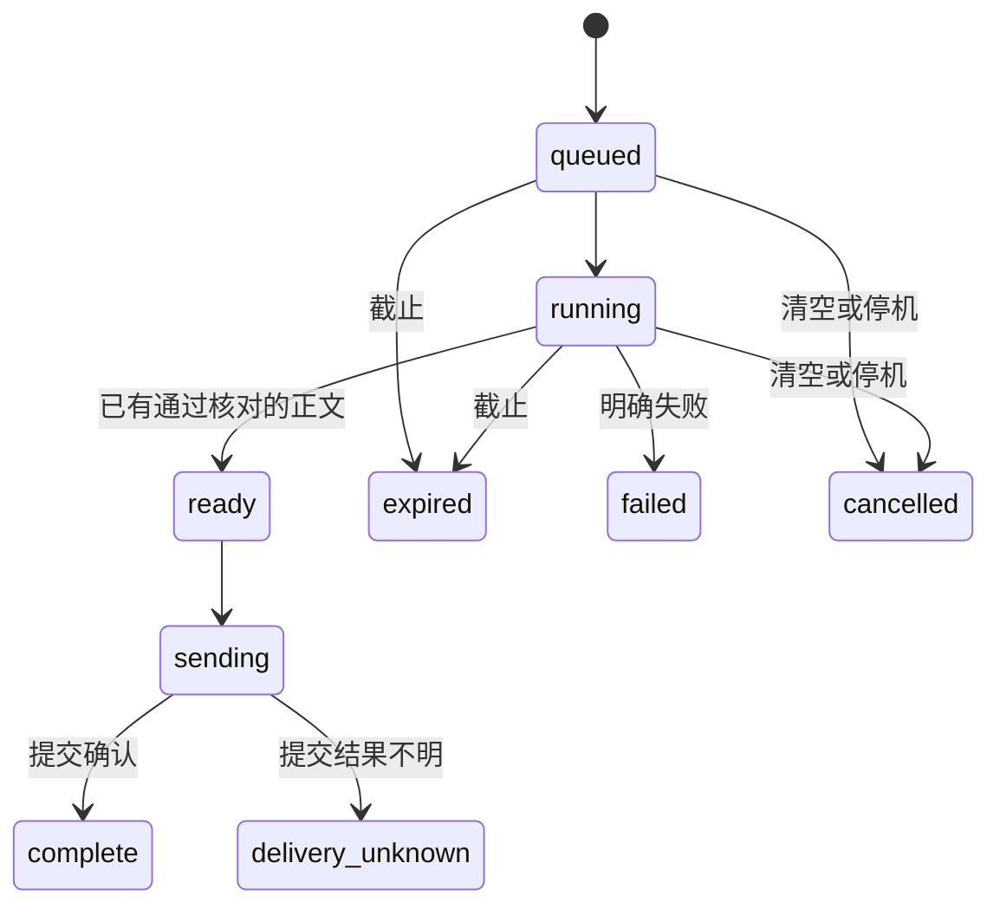

# 群聊回复改进设计

日期：2026-11-17。状态：已按现有模块实施；实际行为与验证结果见[实测记录](群聊回复改进实测-20261117.md)。本稿保留设计参数及候选路径，实施后的 spec 为行为依据。

## 1. 目标与结论

本次覆盖最近聊天中暴露的回复空泛、人物上下文缺失、查证遗漏、语音偏好失效、确认被插话打断、生图进度不可查、引用自生成图片不可见，以及超时后没有交代的问题。

**推荐沿用现有 Python、SQLite、Jev、慢回复队列和微信桥接，补齐“取依据—形成回答—核对—发送”的同一条链路。** 人物相关上下文是普通聊天的基础能力：聊到谁，就围绕当前话题检索谁的相关消息；人物评价只是其中一种用法。Jev 负责语义判断，程序负责身份约束、读取记录、保存状态和执行截止时间。

明确目标与工程建议分开：

- 已明确：研究整套解决方案；修复自生成图片被引用后不可见；人物检索覆盖一般接话、近况、偏好、推荐、比较等场景；超时必须有结束行为。
- 工程建议：下文的时间窗口、调用上限、时限和评分阈值为首轮实现默认值，须经真实回放校准。用户尚未确认“30 秒或 60 秒必须完成”。
- 当前交付：设计、外部资料和验证方案。功能实现后再执行项目既有的测试、重启、公告、提交、推送流程。

| 候选路径 | 收益与成本 | 判断 |
|---|---|---|
| 仅改人格提示词、加大全群上下文 | 改动少；无法持久保存偏好、找回图片、控制后台任务，也难稳定覆盖目标成员 | 可作为生成阶段的局部调整 |
| 在现有链路补定向检索、结构化状态和共享预算 | 能针对已出现的问题改动，复用数据库与守卫，回放可定位每一层失误 | **采用** |
| 建通用 Agent、全面 RAG 或新任务平台 | 涉及存储、编排和迁移，当前问题已有较直接的修复落点 | 本次收益不足以承担扩展成本 |

外部实现对照及固定版本见[调研文档](群聊回复改进调研-20261117.md)。Haystack 分开路由与答案依据评价、Rasa/NoneBot 保存会话状态、Open WebUI 将图片产物回填到消息，分别支持上述局部设计；这些项目没有直接验证本项目的微信原生消息编号关联。

## 2. 当前证据与尚需实验的归因

| 发现 | 当前证据 | 设计对应 |
|---|---|---|
| 人物相关回答泛泛接梗 | 消息 #36246、#36248 之前的原始记录含目标成员 6 条生图请求；实施实测确认普通读取会过滤这些控制命令，定向取材需要显式包含。现有预取主要围绕提问者 | 定向取目标原话，同时检查回答是否用到了具体依据 |
| 群聊窗口与文档漂移 | `MemberStore.conversation_snapshot` 默认全群 25 条，手册写 50 条；另有本人 10 条、连续收发记录至多 40 条，作用不同 | 保留各自用途；人物材料单独获取，修正文档数字 |
| “不知道”绕过搜索 | `ReplyReview.needs_search` 同时依赖公开断言风险与搜索必要性；调用层还先看候选是否被拒绝。已有搜索必要性 0.74、公开风险 0.06 的样本跳过搜索 | 当前问题的资料需求直接驱动搜索 |
| 文字偏好靠模型记忆 | 自然语言要求只影响提示词，未保存成员持久偏好；后续仍可能随机语音 | 识别设置后写现有房间状态，发送层执行 |
| 档案确认被插话消耗 | `ProfileQueries.prepare` 读取时立即 `pop` 待确认状态；原提问者插一句无关话后再确认，状态已丢失 | 分开读状态、路由插话、消耗确认 |
| 生图状态与普通聊天割裂 | 实际任务仍在查询，普通回复却建议重新提交；执行器已有 `task_id`、阶段和文件 | 普通聊天查询同一执行器的真实状态 |
| 引用自生成图片失败 | #36218、#36243 的后续均称未收到图；发送图片没有回填图片记录，原生发送仅返回布尔成功 | 建立产物与发送消息的真实关联，供看图、编辑共用 |
| 延迟叠加、失败静默 | 多层生成、核对、补查各有自己的重试和时限；已有百秒级回复，模型错误按现行规范仅记日志 | 接受请求时启动总预算，明确终态和重试语义 |

普通人格提示中的短字数倾向可能压缩实质回答，需通过同一问题、同一模型的回放比较验证；这两条人物样本的素材已保存在原始消息库；实测发现普通读取的命令过滤会损失生图描述。模型路由变更也可能影响生成表现，本轮尚未完成受控模型对比，先修可观察的链路缺口。

## 3. 人物相关上下文：所有聊到成员的场景共用

### 3.1 从话题决定检索，不依赖“评价”等关键词

“他最近在弄什么”“阿岚终于换风格了”“给他推荐头像”“我和他谁更爱催图”“他之前说不用语音吧”均进入同一能力。无需显式提问，也无需再次要求查看聊天记录。是否实际回复仍沿用现有艾特、接话和主动发言规则；添加检索不会提高主动发言频率。

Jev 一次预判断读取当前话语、引用、短上下文和已知人物候选，分别判断：哪些成员是话题对象、是否需要公开资料、当前回复要解决什么。人物选择通过已提供候选的 ID 返回概率，不让 Jev 编造姓名、微信 ID 或数据库查询。目标可以同时包含提问者和其他成员。

代码处理明确艾特、唯一已绑定名字和引用作者；“他”、外号和跨句接话由 Jev 在本群候选中判断。模糊指代首轮采用最高概率至少 0.85、与下一候选差至少 0.30 的默认条件；多人物明确比较保留全部明确对象，不用单选淘汰另一人。身份仍不清楚时用一句话确认目标。陌生外号不会自动修改人物绑定。外部公众人物走公开资料路径。

### 3.2 定向读取与相关性筛选

复用 `MemberStore.recent_rows`，通过现有共享 `Database` 读取。新增内部人物上下文返回值保留 `entity_id`、已绑定 `wxid`，避免从显示名反查身份。普通生成只接收显示名及材料编号，内部身份字段不进入群回复。

| 项目 | 首轮默认行为 |
|---|---|
| 查询作用域 | 当前账号、群、已确认 `sender_id`，截至本轮提问锚点；遵守清空/重置后的上下文边界 |
| 无显式时间的“最近” | 先取该成员近 7 天至多 60 条原话，保留准确时间；近 24 小时优先但不排除较早的相关变化 |
| 明确时间或旧事 | 按用户指定日期查；只给事件线索时结合已有成员记忆中的源记录定位，再按主题扩展一次。未找到就说具体缺口，避免把 7 天窗口说成完整历史 |
| 去重 | 完全相同的连续请求合并展示并保留次数、首末时间及源 ID；不用重复催图淹没不同话题 |
| 候选预算 | 单人至多 60 条；两人各至多 30 条；更多人均分 60 条，剩余名额给有材料的成员。人数过多导致无法逐人展开时说明本轮覆盖范围并请求缩小目标 |
| 相关性 | 对候选原话批量评分；默认取分数至少 0.50 的前 12 个片段，总正文约 6000 字。明确引用及用户点名的一条原话始终保留 |
| 对话完整性 | 为被选发言补必要的被引用消息及前后至多各 2 条，标明说话者；在同一 6000 字预算内裁剪，优先保留关键原文与时间 |
| 资料来源 | 本人原话、别人对他的描述、已提炼记忆分别标注；机器人此前的推断不充当人物事实 |

Jev 排序是语义判断，数据库作用域、消息 ID、时间和作者由程序确定。评分只决定选材顺序；它不把“一次请求”变成“长期偏好”，也不把转述别人的喜好变成说话者的喜好。讨论变化时同时保留旧偏好与新表态。

现有 `JevClient.noul` 单次最多 64 题，能够容纳上述候选规模；现有 `choice` 需要补充与 `noul` 相同的调用方剩余时间参数。无需引入新的 Jev SDK。新增数据库读取与上下文构建经 `MemberStore` 公共方法注入，遵守 conversation 与 memory 的现有依赖方向。

### 3.3 让取到的消息真正进入回答

按当前话题决定回答形式：问近况就归纳近期在做什么；推荐头像就使用最近明确的审美偏好；接话可只用一个贴切细节；评价、比较需要概括和具体例子。资料足够时应给清楚判断，不用空泛的“挺有意思”“路子挺野”代替。

例如本人先说“头像一直用黑白线稿”，今天又要“暖色水彩小狗，背景留白”，可以接：“这次从黑白线稿换成暖色水彩小狗了，还特意要求背景留白。”实际输出必须由真实材料支持。由生图提示词可归纳所表达的要求；画面实际呈现还需要读取对应图片。

生成阶段把“答题目标、相关原话、时间范围”放在风格压缩之前。普通接话继续短；需要归纳的问答建议 80—180 字，有充分理由再展开，用户要求一句话或详细说明时优先满足。该范围是软目标，发送层不截断正文。

送前核对同时检查两件事：具体判断有依据；回答完成当前请求。人物话题有充分资料却完全没有具体信息，应触发一次修订；资料少则明确以这几条发言为范围。不能为了凑两三个例子制造内容。

### 3.4 本次 Jev 小实验

2026-11-17 使用 Jev `jev-1.14.0` 对 9 个构造场景做一次批量路线分类：近况、陈述接话、推荐、代词接话、比较、评价 6 类进入成员检索；缺指代对象进入消歧；公众人物和一般技术问题分别进入其他路径，9 条均符合预设。

另用 6 条虚构本人发言测试相关性排序：新风格 0.97、旧风格 0.89、具体画面要求 0.68、转述他人且否定其喜好 0.36、下载确认 0.21、午饭 0.02。该结果支持“保留时间变化、适度放宽召回再选材”的首轮方案。小实验未覆盖真实群聊噪声，生产门槛以第 9 节回放为准。实验使用连接工具，尚未验证本项目当前 Jev 路由返回的同等表现。

## 4. 查证与回复质量

将现有相互依赖的判断拆成独立结果，仍批量调用 Jev：

1. 当前问题需要哪些依据：目标成员原话、图片、公开资料，允许组合。
2. 现有依据是否覆盖问题：缺游戏版本、地区或具体对象时先问关键条件。
3. 候选答案是否引入无依据的本地或公开断言。
4. 候选答案是否完成当前请求。

搜索由问题的资料需求触发。回答写成“不知道”仍可能需要搜索；模型自行加入的不相干机制、病因和动机，直接修订，不为这些枝节扩大搜索。私有群聊人物信息只在本地查，搜索词不携带群员 ID 或私人发言。医疗类个体判断需保留条件和不确定性，查到一般资料后也不能补出某个群友的具体病因。

已有依据足够时生成；检查不通过时最多修订一次。补充搜索只在缺口与当前问题有关、尚有一次正文生成机会、且剩余预算足够时进行。统一合并已有资料后重写；不再把普通核对、联网核对、重复避让各自串成独立重试循环。原有重复避让改为优先在初次生成中提供最近回复，必要修订共用这一次机会。

TypeSafe 的官方引用核对示例先核对真实原文，再判断支持关系，适合用于这一步；群聊口语概括用语义核对，逐字引文才做精确匹配。[官方示例](https://docs.typesafe.ai/cookbooks/citation_check)

## 5. 超时：到期结束，并给出可执行的下一步

### 5.1 一轮共享预算

| 请求 | 首轮建议 | 说明 |
|---|---|---|
| 普通文字/看图问答 | 30 秒软进度，90 秒停止业务等待 | 现有聊天单次调用上限 60 秒；整轮直接限 60 秒会挤掉正常查证与发送时间 |
| 明确详细请求 | 30 秒软进度，120 秒停止业务等待 | 篇幅与步骤增加，仍受同一截止时间约束 |
| 生图/改图 | 接单时给状态，沿用 300 秒任务上限 | 聊天问进度读取现有任务；不重新提交 |

预算从接受请求时开始，包含排队、合并/重规划、Jev、读取图片、搜索、主模型、语音合成和发送前等待。中间重试与插话重规划不刷新截止时间。队列已满立即给简短忙碌状态，避免接下后丢失。

正文生成最多 2 次；必要的补查查询生成最多 1 次；全部主模型实际 HTTP 请求合计最多 3 次，JSON 修复也扣次数。搜索最多首查和补查各 1 次。显式生图原有意图判断另走其任务路径。

Jev 按输入依赖分成最多 4 个阶段，同一阶段独立题目合批，包含现有判断，避免在原调用之外再叠加四次：

| 阶段 | 允许的判断 |
|---|---|
| 1：接入与取材计划 | 是否接话、是否收集补充、目标成员、是否看图、从当前文字已能判断的搜索需要。接话路由首次判断即消耗本阶段；明确艾特可跳过路由题 |
| 2：取得初步资料后 | 人物原话相关性，以及看图结果出现后才能判断的搜索需要；合计至多 64 题，人物原话至多 60 条 |
| 3：首稿核对 | 本地/公开事实依据、是否答到问题，必要补查是否针对当前核心问题 |
| 4：修订核对 | 对修订后正文做同一质量检查 |

消息进入候选处理时就记录到达时间；接话路由最多等 2 秒，接受后以原到达时间计算总预算。无需回复的消息不发进度。追加消息与重规划沿用剩余阶段额度，不重新获得四次判断。若已用完取材判断阶段，明确的新引用可由程序直接解析；涉及新的模糊目标则询问澄清，或停止当前候选等待新的明确请求。

Jev 不可用时，明确且唯一的身份仍可按程序检索；模糊指代不得猜人。已执行的取材与调用次数照常计账。核对失败或额度耗尽时，只能发送此前已通过核对的正文、真实运行状态或直接澄清；首次生成尚未通过核对的实质正文不直接放行。主动发言没有可用正文时静默结束。采用该规则需替换现行“Jev 失败沿用正常回复”的约定。

每次调用取“原有单次上限”和“本轮剩余时间”的较小值。剩余不足 5 秒时不再启动新模型或外部搜索，进入收口。已核对好的正文在语音来不及时按文字交付，沿用语音失败的文字回退语义。

### 5.2 状态与用户看到的结果

复用 `SlowReplies` 和现有发送守卫，在插件内增加小型每轮状态。一个随插件启停的检查器维护等待中的软进度与截止时间，无需为每条请求单独创建定时线程。

| 当时状态 | 到期动作 |
|---|---|
| 有已通过核对、可独立使用的完整正文，尚未发送 | 交付该正文；仍缺少的具体内容可简短标注 |
| 尚无可用正文 | 发送一次阶段性失败状态，例如“这次检索超时，还没拿到可核实的结果；回复‘重试’可以接着查。” |
| 只有被否决的草稿或未核对资料 | 不截取冒充已核对答案，按无可用正文收口 |
| 原生发送已经提交、回执不明 | 标记 `delivery_unknown`，停止补发；在可查询回执前不承诺成功、不自动复制发送 |
| 连接失效或已停机 | 保存结束原因到本地日志；恢复后的新请求不继承旧发送资格 |

30 秒进度只发送一次，内容来自真实阶段，如“正在查他最近的相关发言”或“正在核对搜索资料”。进度不能把排队说成正在搜索。软进度发送和正文发送共用每轮状态与守卫，完成后取消进度资格。

截止由单一收口者原子接管：在短锁内关闭旧工作任务的发送资格，并保留一次收口发送资格，用于已核对正文或运行状态，二选一。收口资格提交前仍检查连接、清空和人格等现有守卫。网络发送在短锁外执行，避免截止检查被耗时发送堵住。若该轮已进入 `sending`，收口者不再发送第二条结果，只更新等待/回执状态；进度已在发送中的，收口内容排在该次进度提交之后。最终提交后销毁收口资格。

截止时停止后续编排，并关闭旧工作任务的发送资格；已经启动的线程可能继续执行，其迟到结果不再发出，只有上述收口者还能提交一次结束结果。Python `Future.cancel()` 无法停止已运行任务，实际网络取消能力需逐个适配器处理。[Python 官方说明](https://docs.python.org/3.12/library/concurrent.futures.html#concurrent.futures.Future.cancel)

90/120 秒是停止业务等待的界限；微信连接和回执决定最终投递时间。监控分别记录“业务到期”“状态提交”“回执结果”，避免把本地调用结束统计成群里已收到。

### 5.3 重试的具体含义

最近一次失败请求在当前连接、同群同成员下保留 5 分钟，包含原问题、引用目标和已取得的资料。用户说“重试”时：

- 原任务仍运行：返回真实阶段，不创建第二份任务。
- 文本检索/生成失败：以原问题发起一轮新预算，复用仍有效的材料；新的明确问题替换重试对象。
- 生图已有远端 `task_id`：查询同一任务；远端失败后，重新生成须有明确的新生成指令。
- 图片文件已经生成、发送明确失败：重试发送该文件；回执不明先核实状态。
- 已过期、清空、人格/连接变化导致守卫失效：明确说明需重新提出请求，不恢复旧的发送资格。

当前规范要求模型失败静默；本方案拟增加的是面向已受理请求的运行状态回执。主动闲聊失败仍沿用静默规则。实施时需要同步修改该行为约定。

## 6. 自生成图片：生成结果也成为可引用资料

### 6.1 同一份资料供看图和改图使用

把图片产物登记为本群已发送图片，优先使用已有 `.runtime/generated_images/` 本地文件。看图与引用改图共用一个解析入口：按引用服务器消息编号查，再按已验证的图片 md5 查；显式引用匹配失败时不替换成最近一张。

现有 `RECENT_IMAGES` 保留短期缓存；增加范围明确的 `sent_images` 持久记录，归现有 `Database` 与迁移入口管理。最小字段包括账号、群、发起消息 ID、任务 ID、本地文件、发送状态、生成时间，以及实际可取得的消息标识；未取得的字段保持空值，不能制造编号。查询遵守上下文重置边界。

发送后缓存与持久记录指向同一文件。重启后收到明确引用可从持久记录恢复；改图产物再次走同一登记流程。传给看图模型和改图工具的内容必须来自同一解析结果。历史图片只有同时找到本地文件和可信发送关联时才回填。

### 6.2 首要技术验证：拿到真实关联

目前 `send_image` 只返回成功布尔值，`image_send.h` 的发送报告也没有图片消息 ID。接收桥接能读取图片消息的服务器编号，但自己的发送回声是否稳定、何时到达，以及引用 md5 是否等于源文件 md5，尚需实际微信链路测量。

实施第一步安排两张易区分图片的受控发送与引用，检查以下路径，选实际成立的最小改动：

1. 自己发送的图片能收到带服务器编号的同步回声，且能按已验证的客户端标识或文件摘要关联到本次发送，则在回声时绑定。
2. 引用包含的 md5 与实际发送文件一致，则按已登记的账号、群、文件摘要定位，并补绑该服务器编号。
3. 上述均无可靠关联时，扩展原生图片发送报告，读取经过当前微信版本实测的客户端标识，再与同步消息关联。不得猜内存偏移或照搬其他项目的编号。

这项验证决定桥接补丁的具体位置，设计阶段不声称已解决。验收必须覆盖“连发两张后引用第一张”，避免误将时间接近当成身份一致；也要覆盖当前没有缓存的重启后引用。

### 6.3 普通聊天查询任务

`ImageReply` 对外提供只读任务摘要：发起者、原始请求关联、排队/提交/查询/下载/发送/成功/失败、可恢复的任务 ID 或文件。普通聊天识别“图呢”“还没好吗”后读取摘要，再回答实际状态。

任务仍运行时不建议重提请求。引用“画好了”这类文字消息时，只在已保存的消息与任务关联唯一时定位对应图片；引用图片本身优先按原图片身份处理。图片成功发送与“画好了”提示的顺序同步调整，只有确认提交图片后才说已发出。

## 7. 偏好与确认状态

### 7.1 自然语言文字偏好

沿用 `RoomStateStore`，在账号、群、成员作用域保存 `text` 偏好；缺省保持现有自动选择。读改写使用现有数据库事务，避免两名群友同时设置时互相覆盖。

Jev 判断“以后只发文字”等明确持续要求；“这条用文字”只影响当前轮；引用、第三人要求和玩笑不改本人持久设置。保存成功后才确认。所有实际聊天回复的最终发送点都读取同一设置，包含排队中的后续回复。

首轮优先级保持现有管理员固定语音约定：管理员固定语音 > 本轮明确形式 > 本人持久偏好 > 普通自动语音。固定语音与本人文字偏好冲突时说明当前实际设置，不承诺后续只发文字；偏好仍保存，管理员解除后生效。语音合成失败、共享预算耗尽时仍可按现有回退方向发已完成文字。

### 7.2 档案查询的确认

继续沿用 5 分钟有效期与当前会话、群、成员键。读取时不删除；明确确认、明确取消、新同类查询替换、过期或生命周期失效才消耗状态。

无关插话正常回复并保留确认。用户引用原确认消息，或明确说出候选名字/序号，可以接续。裸“对/是”仅在前一个对该用户提出的待答问题仍是这次确认时接受；中间出现其他需要回答的问题时，由 Jev 判断承接对象，模糊则再确认一次。其他人的“对”不替代原提问者操作。

确认完成只选择本次查询目标，人物身份绑定仍由原权限入口负责。

## 8. 改动落点与实施顺序

| 工作包 | 主要落点 | 完成条件 |
|---|---|---|
| A：人物材料与回答质量 | `conversation/context_tools.py`、`members.py`、`history.py`、`memory/knowledge.py`、`dialogue.py`、`reply_review.py`、`personality.py`、`plugins/mention_chat/__init__.py`、`plugins/proactive_chat/__init__.py` | 所有人物话题进入定向上下文，身份正确、原话可追溯、输出完成请求 |
| B：统一等待与搜索流程 | `conversation/slow_replies.py`、`mention_tools.py`、`integrations/llm.py`、`integrations/jev.py`、`deadline_http.py` 及插件编排 | 队列到发送前共用截止时间，有限修订，到期有收口，迟到不发 |
| C：图片引用和任务状态 | `plugins/mention_chat/image_reply.py`、`recent_images.py`、`native/text_service.py`、原生图片报告、SDK 回复入口及共享数据库 | 原生关联实测通过，看图与改图共用定位，重启后仍能引用 |
| D：偏好与确认 | `plugins/mention_chat/voice_reply.py`、`conversation/room_state.py`、`profile_queries.py` | 偏好先存后确认，最终发送执行；插话后可正确接续确认 |

自然接话与定时主动发言在既有发言决策通过后、`generate_proactive` 生成前，调用同一人物上下文构建与核对能力；`generate_proactive` 增加该材料的显式输入。主动分支保留原有发言预算和频率，不发送 30 秒进度、失败状态或重试邀请。其人物选材和核对同样遵守调用上限及发送守卫。艾特、连续追问、自然接话、定时主动发言分别跑真实入口验收。

优先进行 C 的原生关联验证，尽早明确最不确定的技术点；功能实现按 A、B、C、D 分成可独立回放的改动。A 的 Jev 调用与 B 的预算接口一起设计，避免先加判断次数再处理延迟。

同步更新现有 spec 与手册，明确以下冲突：

- 手册全群 50 条与代码默认 25 条：以当前代码为事实，人物历史增加单独来源。
- 原非详细回复统一长度统计：改为闲聊、实质问答分别验收，保留用户既有短聊目标。
- 原模型错误静默：已受理请求增加一次运行状态结束回执。
- 原普通核对两次重写、联网补查另有 60 秒：改为共享预算和统一修订次数。
- 原 Jev 核对失败沿用正文：改为保留已核对结果或运行状态收口，主动分支静默结束。
- 原插话导致确认取消：改为保留状态并判断确认承接对象。
- 原图片仅临时缓存、生成结果没有可引用关联：增加发送图片记录与统一解析；新任务仍不在重启后自动重新生成。

## 9. 验收：从真实入口检查结果

原始群消息和完整模型输入留在 `.runtime/` 私有回放资料中；版本化测试使用虚构姓名和改写语料。回放固定提问时间、消息锚点和模型配置，防止把提问之后的消息泄漏进历史。

| 组别 | 必须覆盖的场景与通过标准 |
|---|---|
| 人物检索 | 近况、陈述接话、推荐、比较、评价、跨句“他”、外号消歧、同名公众人物；检索者身份及时间准确，目标原话进入生成输入 |
| 人物归纳 | 两条已有 6 条原话仍空泛的实际样本回放；给出贴合问题的具体概括，事实能回到源 ID；不能只复述一条催图或审核状态 |
| 材料变化 | 旧偏好与新表态、转述他人、玩笑、反话、材料不足；保留变化，不把他人属性归给目标、不编造长期性格 |
| 搜索 | 不知道仍搜、群内人物只本地查、缺版本先问、无关公开断言删除；不会为了修饰性枝节增加搜索 |
| 超时 | 排队超过软/硬界限、Jev/搜索/LLM 卡住、嵌套重试、语音预热、发送回执不明；只产生允许的进度与最终结果，期限不刷新、迟到不再发 |
| 图片 | 生成→引用看图→引用编辑→再引用新图；连续两图引用首图；重启后引用；文件缺失明确说明；不会拿最新图片顶替 |
| 图片状态 | 排队、进行中、远端拒绝、生成完成但发送失败；“图呢”返回对应真实任务，重复询问不提交新生图 |
| 偏好 | 持续与单轮要求、引用别人的要求、两人同时设置、重启、排队回复、管理员固定语音冲突；确认和实际行为一致 |
| 确认 | 原提问者插话后明确确认、他人插话、他人确认、换题后裸“对”、过期及取消；查询不串人、不改身份绑定 |

自动检查覆盖真实存储、检索、队列和发送守卫；仅对外部耗时服务使用可控卡住/失败替身。真实 Jev 与主模型回放另外记录，不能用 mock 的固定判定代替回答质量验收。原生图片关联需实际微信发送与引用验证。

先以至少 30 条人物相关样本、20 条查证/缺条件样本、10 条状态与偏好样本建立基线。确定性的身份、作用域和发送次数场景必须全部通过；模型输出逐条人工标注“答到问题、具体依据、事实支持、自然程度”，人物相关样本至少 90% 同时通过前三项，任何串人或凭空捏造原话都先修复。未通过样本保留到现有质量待办，修复后复跑受影响分组。

每轮日志记录请求锚点、目标内部 ID、选材源 ID、阶段耗时、模型/搜索次数、核对结果与终态；默认不重复记录完整原话和密钥。分别统计首个有用答复与最终正文的 p50/p90、超时率、空泛率和事实错误数，避免用进度通知冒充回答速度。

验收先确保“取对人、用对消息、回答具体、失败有交代”。时间与评分默认值随这批回放调整，全部必要检查通过后再按仓库既定流程交付功能。

## 实施后的参数与行为

实际整轮预算为普通90秒、详细120秒；主模型HTTP最多3次、Jev最多8次、搜索最多2次。Jev额度覆盖现有接话、看图依赖判断、人物识别/选材与核对，保留看图之后才能决定搜索的依赖顺序。

人物读取近7天至多60条、选至多12条且6000字，显式包含本人控制命令；已有明确称呼由程序定位，指代交给Jev。历史旧事没有进入当前材料时据实说明范围，当前版本没有新增全文或向量检索。

图片实测确认真实引用md5与生成文件一致，采用摘要定位；自己的发送没有同步回声，因此不依赖该路径补绑编号。旧产物仅在真实引用作者为本账号且摘要完全相同时回填。

机器人本机配置固定为已回放的 `codex/gpt-6.1-terra`，共享 `group/bot` 保持原配置。两种路由的同样本结果、时延和严格事实检查边界见实测记录。
