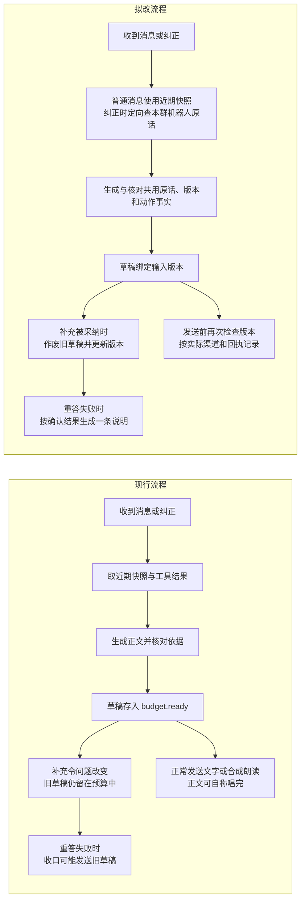

# 群聊纠错与发送设计

2026-11-20 · 已确认并实现 · 对比基线 `34c88b3`

群友指出机器人说错时，回复要用原话核对。接受新条件后，只有按新条件生成并核对的正文还有发送资格。涉及语音时，以实际能力、动作和发送结果为准。措辞由当前群人格自然生成，沿用现有模型、Jev 和 Magpie 路由。

## 现行与拟改流程

可优化的地方有三处。只在纠正时读取较早的记录，避免把每天的日常聊天都变成长上下文。生成和核对使用同一批原话与程序事实，避免两边各自理解这轮发生了什么。正文与失败收口共用发送资格判断，消除两条路径能发出不同版本答案的问题。性能收益等回放测量，比较模型调用次数、Jev 次数与首条可发送回复的耗时。

增大每轮快照能让更多旧话进入模型，但增加常态调用成本，仍需要处理重答版本和语音回执。采用已确认的定向回查方案，在现有模块补齐证据、版本及动作事实。

## 模块与规则

| 模块 | 计划改动 |
|---|---|
| [`conversation/history.py`](../wxbot_framework/conversation/history.py) / [`conversation/members.py`](../wxbot_framework/conversation/members.py) | 增加定向读取机器人的已发送原话。复用 SQLite、当前消息锚点和 `context_floor`。返回原文、消息 ID、时间和类型。 |
| [`conversation/turns.py`](../wxbot_framework/conversation/turns.py) / [`plugins/mention_chat/__init__.py`](../plugins/mention_chat/__init__.py) | 在艾特、引用或已经判定为接话的消息中，识别「在纠正机器人先前的说法或动作」。复用已有 Jev 判断与轮次上下文。只有命中才拉取历史。同一轮接受影响答案的新条件时，先使旧版本失效，再按新条件生成。 |
| [`conversation/dialogue.py`](../wxbot_framework/conversation/dialogue.py) / [`conversation/reply_review.py`](../wxbot_framework/conversation/reply_review.py) | 生成与发送前核对共用证据。纠错时核对候选是否忠于机器人原话、当前事实和已知动作，是否擅自否认、归责或解释动机。仅在相关分支把该判断并入现有 Jev 请求。沿用现有一次修订与整轮预算。 |
| [`integrations/reply_budget.py`](../wxbot_framework/integrations/reply_budget.py) / [`conversation/reply_wait.py`](../wxbot_framework/conversation/reply_wait.py) | 在同一轮预算里绑定当前输入版本和已核对草稿。采纳补充时在预算锁内更新版本并清空旧草稿。正常发送与超时收口均校验版本、当前会话和快照；还有未处理的同一轮补充时，收口也不能抢发草稿。 |
| [`plugins/mention_chat/voice_reply.py`](../plugins/mention_chat/voice_reply.py) / [`plugin_engine/context.py`](../wxbot_framework/plugin_engine/context.py) / [`conversation/status_replies.py`](../wxbot_framework/conversation/status_replies.py) | 生成前提供能力事实「文字朗读」。合成与发送后复用既有发送返回值与语音记录，区分朗读已提交、合成失败转文字、结果未确认。失败或追问时用已确认结果生成说明。状态核对单独检查是否把朗读说成唱歌、是否承诺当前能力做不到的操作。 |

### 原话怎么查

1. 按纠正消息实际到达时间往前取 **14×24 小时**。只查当前机器人账号、当前群、当前消息之前、最后一次 `/清空` 之后的 `bot_generated` 记录。文字和语音正文都可作为证据。
2. 明确引用优先按消息编号或可核实的原文定位，仍应用同一范围。只有引用预览、群友复述或历史总结时，把它们当定位线索。无引用时，用纠正中给出的人名、别名和话题词，从原文挑少量相关候选，保留出处。
3. 查到匹配原话就承认说过。若证据表明之前答错，指出错在哪并更正。若原话只是玩笑或带条件，保留当时语境。只查到相似句、证据互相冲突或没查到时，按已有证据表达不确定，需要时请对方引用。公开事实可以沿用现有查证路径，群聊原话用于核对谁说过什么。

### 草稿与语音的发送资格

- **草稿跟随输入版本。** 重答共享原来的截止时间和调用预算。到期时，只有已经核对的当前版本草稿可在发送守卫内提交。当前版本生成或核对失败时，用实际失败状态收口。若已经开始发送、部分提交或回执未确认，保留现有一次收口约束。后续纠正开启新回复，不重发未确认内容。
- **语音动作取自程序。** 请求「唱」时先让模型知道目前只有文字朗读能力。先自然说明可以朗读，在同一发言者接受朗读提议后再读，确认沿用现有连续接话的 30 秒窗口。语音收到提交结果后，后续追问可确认已提交朗读语音。合成还未发送、改发文字或回执不明时，按相应状态表述。
- **生成和核对沿用现有模型配置。** 查证失败、生成失败或候选二次核对仍未通过时，沿用现有收口。说明由模型组织，程序提供可确认的事实和允许的动作。

## 回放验收

从本机聊天数据库和 Magpie 请求归档提取对应片段，保留时间间隔、发送者关系、引用、合并条件和回包类型。提交到仓库的测试样本使用代称和虚构标识。先在 `Plugin.on_message`、`ReplyWait` 和发送接口上用可控时钟及替身微信后端回放，断言实际发送次数、内容约束、聊天记录来源和草稿版本。再用当前模型和路由对相同的脱敏输入生成，人工核对意思和自然度，并记录路由实际选中的模型和耗时。回放发送目标为测试后端。

| 已排查片段 | 如何构造回放 | 通过条件 |
|---|---|---|
| **婚梗被否认**，11 月 13 日 23:24 / 19 日 12:32 | 把先前选择某群友的机器人语音原文保存在同群，放在日常快照之外。补一条当天相反的玩笑，再发「你之前说过……」。同时加一条群友复述作干扰。 | 找到六天前的机器人原话，按当时的玩笑语境承认并纠正绝对否认。移走原文，或把它分别置于 14 天窗口之外、另一群、另一账号、`/清空` 之前和当前消息之后，均不能据此承认或否认。明确引用同样经过范围校验。 |
| **道馆等回复时编门票**，11 月 18 日 18:58–19:00 | 程序只提供「组织回答」，向状态核对提交旧的「靠门票回血」。失败时提交「刚才没查准」，记录该轮没有搜索。 | 两个旧候选都被拒绝。能生成通过核对的进度或失败说明时，只发送一条对应状态。群友补明「现实里的店」后，可以按新问题继续走正常查证。 |
| **读歌词却说唱完了**，11 月 19 日 00:48 / 01:01 | 一组为明确唱歌请求，并在候选生成期间插入「你这只是念的」。另一组注入连接失败或超时，向核对提交「卡壳没唱出来、重试给你唱」旧候选。另测朗读成功、合成失败转文字、回执未确认。 | 明确唱歌请求获得真实的能力说明。已发的朗读可以承认是朗读；其它分支只陈述程序能确认的结果。旧候选即使语气自然也被拒绝，不承诺唱歌或声称唱过。「失败或结果未确认」不写成成功。 |
| **火系改水系后旧稿被发**，11 月 19 日 11:38–11:40 | 先让火系草稿生成并通过核对，在发送守卫之前插入水系更正。分别让新答案成功、连接失败、核对失败和整轮超时。 | 成功时只发水系答案；其余分支都不能发旧的火系正文。失败说明最多一条。补充与收口交错时，旧版本也不能进入发送接口。 |
| **1600 分被反问后说在捧场**，11 月 19 日 22:56–22:58 | 先给出机器人说「高手分段」的原话，再用「全球前十万就是高手？」作为纠正。分别提供可核实的榜单信息和资料缺失两种输入。 | 承认前一句下结论太快。资料充分时按证据更正，资料缺失时交代没核实。已知事实中没有搜索或动机依据时，回复不能声称查过、查不了或当时故意捧场。 |

还要回放一条正常闲聊和一条正常语音，确认它们继续走原有流程，日常聊天没有触发 14 天回查。保留上次的两份内容拦截回包作为回归样本，只回放响应，检查文字收口和追问。对于自然措辞，验收只固定事实、发送资格与渠道；不固定句子。

### 回放结果

| 片段 | 实测结果 |
|---|---|
| 婚梗 | Jev 找到六天前的语音原话，拦下用「为了蹭饭」解释动机的候选。重写后自然承认原话。离线测试覆盖群、账号、时间、消息锚点和 `/清空` 边界。 |
| 道馆 | Jev 拒绝了「靠门票回血」和「没查准」两条旧提示。现有模型的进度生成实测耗尽 25 秒预算，程序跳过提示。离线回放确认候选通过核对时仅提交一次。 |
| 唱歌与朗读 | 已用现有模型生成能力说明，同一人接受后测试后端收到朗读。Jev 拒绝了旧的「唱感动」和「重试给你唱」候选。 |
| 新条件重答 | 离线回放覆盖重答成功、连接失败、核对失败和超时。成功时发送水系答案，其余分支都没有发送火系旧稿。另测收口遇到待处理补充时，旧稿已失去提交资格。 |
| 1600 分 | Jev 拒绝编「捧场」动机，也拒绝缺资料时反向断言。无资料时现有模型承认说得太满。有模拟榜单时按榜单更正。 |

895 项离线测试通过。两份原始拦截回包离线解析仍被识别为内容拦截。
