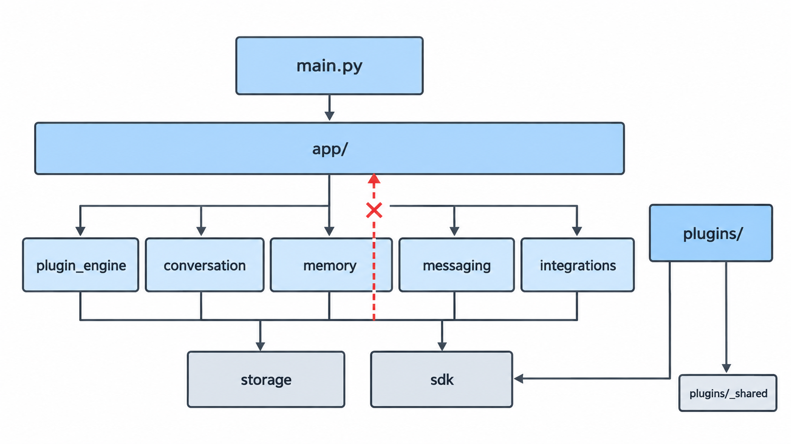
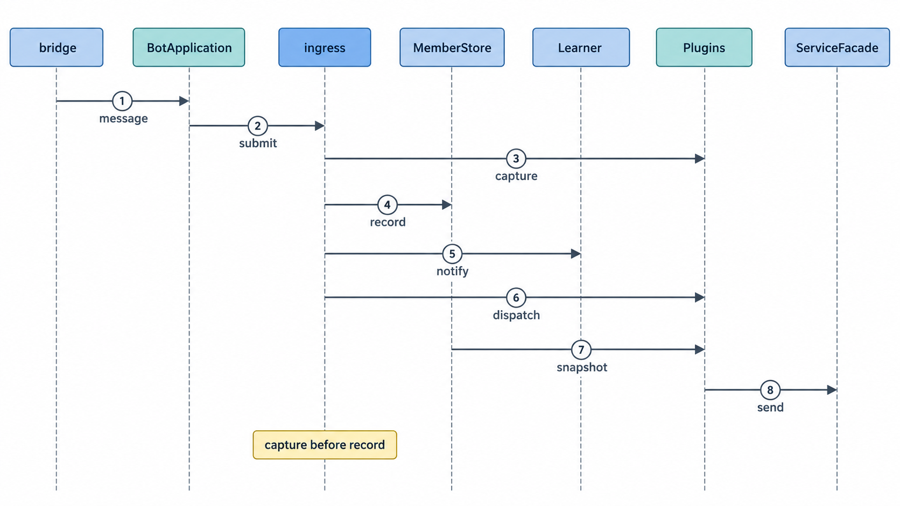
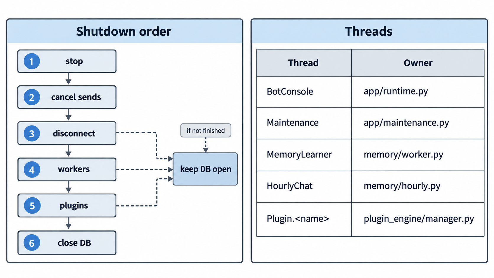

# 架构与阅读指南

面向要读懂或扩展本框架的人。目标：**沿一条消息读完整条调用链**，新增功能有确定落点，依赖越界有检查。

## 一、按这个顺序读

先读 `app/`，它把其余部分串起来；其余包按需深入。

| 顺序 | 文件 | 职责 | 读完能回答 |
|---|---|---|---|
| 1 | `main.py` | 参数解析与启动 | 程序从哪里开始 |
| 2 | `app/bootstrap.py` | 装配与显式初始化（唯一建库入口） | 对象如何组装、数据库何时创建 |
| 3 | `app/runtime.py` | 主循环、重连、动态设置 | 进程如何运行与退出 |
| 4 | `app/ingress.py` | 一条消息的处理顺序 | 消息先经过谁、后经过谁 |
| 5 | `plugin_engine/manager.py` + `context.py` | 插件发现、加载、分发 | 插件如何被调用 |
| 6 | `messaging/delivery.py` | 发送、节奏、取消 | 回复如何发出、何时被取消 |
| 7 | `conversation/history.py`、`memory/learning.py` | 记录与学习 | 历史与知识如何写入 |
| 8 | `app/bootstrap.py` 的 `release()` | 停止与释放 | 资源按什么顺序关闭 |

## 二、目录与职责

| 目录 / 文件 | 职责 |
|---|---|
| `main.py` | 统一入口：参数、日志、检查分支、启动 |
| `wxbot_framework/sdk.py` | 插件可用接口的稳定导出 |
| `wxbot_framework/config.py` | 配置读写与纯校验 |
| `wxbot_framework/feature_config.py` | 功能选项解析与维护选项 |
| `commands.py` / `authorization.py` / `timeutil.py` / `locking.py` | 根级纯工具 |
| `account.py` / `contacts.py` / `lore.py` | 根级纯工具，不为整齐再建杂项层 |
| `app/bootstrap.py` | 装配、显式初始化、停止释放 |
| `app/runtime.py` | 主循环、重连、动态设置、控制台线程 |
| `app/ingress.py` | 消息处理顺序 |
| `app/console.py` | 本地控制台命令 |
| `app/control.py` | 维护命令需要的运行控制能力 |
| `app/maintenance.py` | 维护服务与消息路由 |
| `app/checks.py` | `--check` / `--list-plugins` |
| `app/announcements.py` | 启动公告队列与发送 |
| `app/upgrades.py` | 本机资料修订 |
| `messaging/` | 消息模型、发送、节奏、接收水位、文本与艾特工具 |
| `plugin_engine/` | 清单、发现与加载、插件上下文 |
| `conversation/` | 成员与历史、群状态、对话、总结、人格、清空控制 |
| `memory/` | 知识库与维护、增量学习、学习调度、主动发言候选与调度 |
| `storage/` | 唯一连接与事务、集中迁移 |
| `integrations/` | 原生微信后端适配、大模型客户端 |
| `plugins/_shared/` | 插件之间的只读数据契约（如接龙状态解释） |
| `plugins/_template/` | 插件模板 |
| `plugins/` 各功能插件 | 保留原目录名与生命周期入口 |
| `.spec/project/` | 根规范与关键行为规范 |
| `native/` | 原生桥接源码与 DLL |
| `tests/` | 离线测试 |
| `tools/` | 配置初始化、离线维护与迁移脚本 |

## 三、依赖方向



图注：红色叉号表示禁止方向——底层不得导入 `app`，由 `tests/test_architecture.py` 静态检查。

| 规则 | 说明 |
|---|---|
| 装配只发生在 `app` | `main → app → 功能模块 / 插件引擎 / 适配器` |
| 单向依赖 | `memory` 可用 `conversation` 的公开成员与版本接口；`conversation` 不反向依赖 `memory` |
| 引擎不认识插件 | `plugin_engine` 不引用具体插件；入口也不按插件名判断服务需求 |
| 插件边界 | 插件通过 `sdk.py` 与公开功能接口工作，插件之间只共享 `plugins/_shared/` 的只读契约 |

## 四、一条消息的完整路径



图注：编号 1–8 为一条消息的主链路顺序；`Learner` 即 `MemoryLearner` 学习线程。`ingress` 内的 allowlist 过滤、快速上下文清空、维护分流与人格兼容步骤未在图中展开，完整顺序见 `app/ingress.py`。

| 关键点 | 含义 |
|---|---|
| `capture` 先于落库 | 落库慢时，发题水位仍能排除“已经收到但尚未入队”的答案 |
| 同一份群状态快照 | 同一条消息的所有插件拿到同一份群状态；已捕获的空状态不会被后来的游戏状态替换 |
| 发送前 `guard` | 校验会话、等待节奏、再判定 `guard`；清空、跨天或重连后的旧回复会被取消 |
| 落库失败 | 只记录日志，消息继续分发到插件 |

## 五、资源与线程

**一个数据库**：`storage.Database` 持有唯一 SQLite 连接、可重入锁、可嵌套事务与备份。成员、历史、知识库与群状态共用它，不各自开连接。

**事务由用例控制**：学习提交把知识、来源、mentions 与游标放进同一外层事务；下层写方法只执行 SQL，异常沿调用栈抛出，不会留下半批结果。



图注：原生清理失败、后台线程或插件未退出时均报告停止未完成、数据库保持打开；右侧为线程归属。

| 线程名 | 作用 |
|---|---|
| `BotConsole` | 读取标准输入的命令行 |
| `Maintenance` | 维护命令队列 |
| `MemoryLearner` | 增量学习调度 |
| `HourlyChat` | 主动发言调度 |
| `Plugin.<名称>` | 每个插件的消息队列 |

线程归属见图片右侧表格；新增后台任务时同步更新图片与上表。

## 六、最短扩展路径

### 新增普通插件

1. 复制 `plugins/_template/`，目录名即插件名。
2. 写 `plugin.json`：`api`、`requires`（后端能力）；需要模型时声明 `"services": ["llm"]`，入口与检查会自动识别。
3. 实现 `Plugin.on_message(message, ctx)`；可选 `on_load(ctx)`、`on_unload(ctx)`。
4. 通过 `ctx` 使用公开能力；跨插件数据放进 `plugins/_shared/`，不要导入其它插件。
5. 运行 `python main.py --check` 验证清单与语法。

### 新增持久状态

1. 表结构加进 `storage/migrations.py`，保持既有表、主键与升级次序。
2. 状态归属于某个功能包（如 `conversation/room_state.py`、`memory/knowledge.py`），使用注入的同一个 `Database`。
3. 写操作放进外层事务；读取用公开查询方法，避免外部直接执行 SQL。
4. 补一个离线测试，覆盖“写入失败不留半批状态”。

### 新增后台任务

1. 在 `memory/` 下实现，线程名加入线程表与配图。
2. 提供 `close()`，在超时后能报告“尚未退出”。
3. 在 `app/bootstrap.py` 的 `release()` 顺序中登记，确保停止时不跳过原生清理。

## 七、规范与测试

| 文档 | 约束 |
|---|---|
| `.spec/project/spec.md` | 边界、依赖方向、资源归属 |
| `.spec/project/messages/spec.md` | 消息接收顺序、capture 与水位 |
| `.spec/project/learning/spec.md` | 学习批次的快照、事务与丢弃 |
| `.spec/project/delivery/spec.md` | 发送校验、节奏与取消 |
| `.spec/project/lifecycle/spec.md` | 启动、重连与停止确认 |

验收命令：

```powershell
python -B -m unittest discover -s tests
python -B main.py --config <合成配置> --check
python -B main.py --config <合成配置> --list-plugins
```

## 八、事实、目标与边界

| 类别 | 内容 |
|---|---|
| 重构前的事实 | 成员库同时持有数据库基础设施，其他存储借用其私有连接、锁与时钟；知识库可能由读取上下文的动作隐式创建；入口按插件名判断模型需求 |
| 已经验证 | 上文的目录、依赖方向、处理顺序、事务边界与停止确认，由 370 项离线测试覆盖；`--check` 与 `--list-plugins` 不建库、不注入微信、不请求模型 |
| 仍未验证 | 原生 C++ 内部结构、真实微信环境的长期运行表现、真实数据库上的一次完整升级；这些需要单独授权与单独验证 |

> 图片的 Mermaid 源文件保存在 `docs/diagrams/*.mmd`，供改图参考；正文以 `docs/images/` 中的 PNG 为准，不嵌入 Mermaid 代码块。
